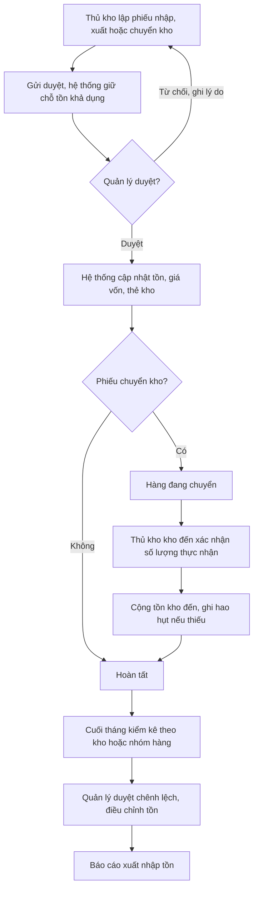
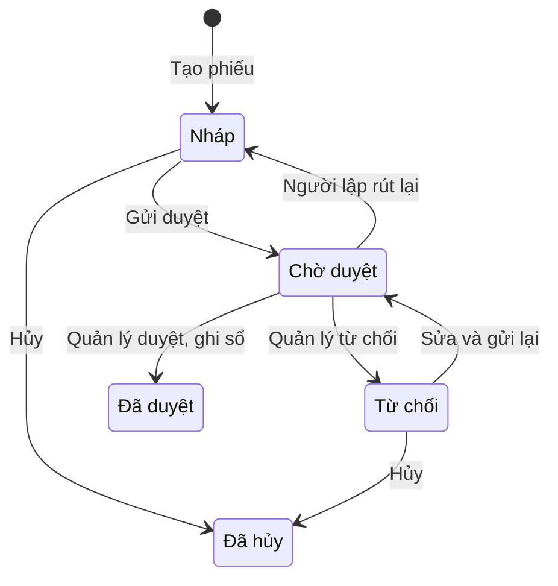
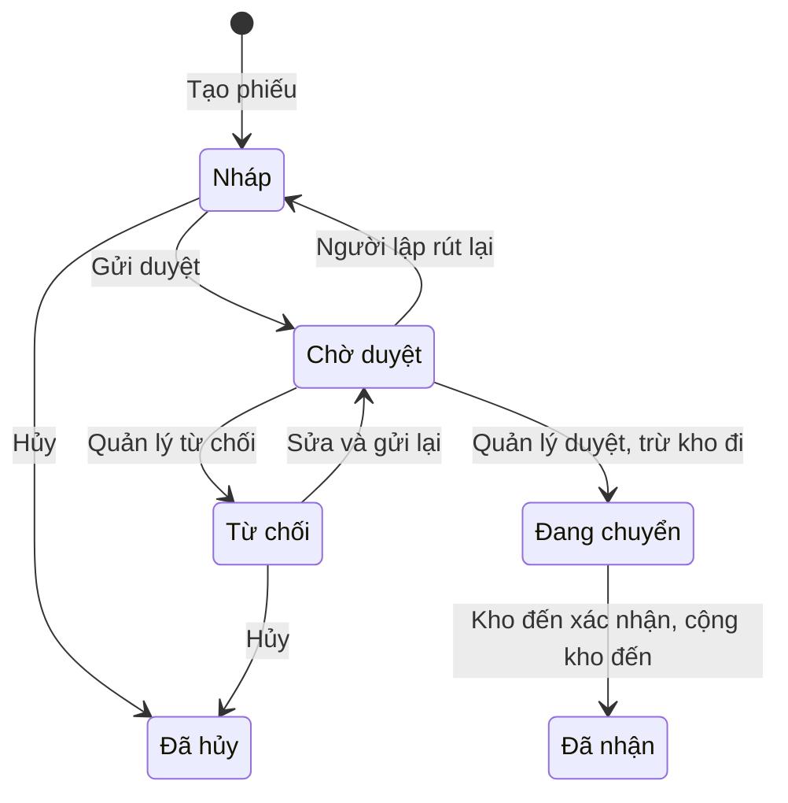
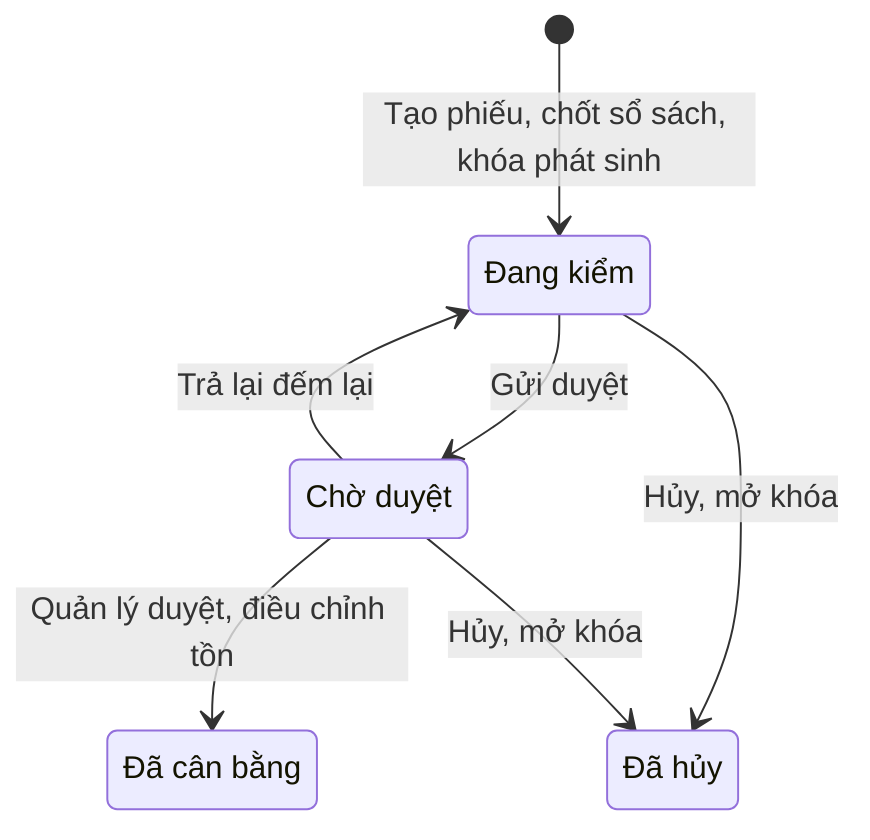

# Đặc tả yêu cầu phần mềm (SRS) — Quản lý Kho

| Phiên bản | Ngày | Trạng thái |
| :--- | :--- | :--- |
| 1.0 | 12/10/2026 | Bản nháp để triển khai demo |

> Cách viết, quy ước mã, mức độ chi tiết: `ZDOCS/05-HUONG-DAN/HUONG-DAN-VIET-TAI-LIEU-NGHIEP-VU.md`.
> Phần nền (đăng nhập, tài khoản, vai trò, cài đặt, đặt lại dữ liệu demo): `ZDOCS/03-KIEN-TRUC/USE-CASE-NEN.md`, không viết lại ở đây.

---

## 1. Giới thiệu

### 1.1. Mục đích

Tài liệu mô tả đầy đủ yêu cầu của bản demo Quản lý Kho: danh mục, phiếu nhập, phiếu xuất, chuyển kho, quy trình duyệt, tồn kho, thẻ kho, kiểm kê, cách tính giá vốn và báo cáo xuất nhập tồn. Dev dùng để code, tester dùng để viết và chạy test case, sales dùng để biết demo làm được gì.

### 1.2. Phạm vi

**Trong phạm vi:** kho, nhà cung cấp, nhóm hàng, hàng hóa với đơn vị quy đổi; phiếu nhập (có phân bổ chi phí mua hàng), phiếu xuất, phiếu chuyển kho, tất cả qua duyệt; tồn thực và tồn khả dụng theo từng kho; giá vốn bình quân gia quyền theo từng kho; thẻ kho; cảnh báo tồn tối thiểu, tối đa và đề xuất số lượng nhập; kiểm kê theo kho hoặc nhóm hàng, điều chỉnh chênh lệch; in phiếu theo bố cục mẫu 01-VT, 02-VT, 05-VT; báo cáo xuất nhập tồn, hàng chậm luân chuyển.

**Ngoài phạm vi:** thiết bị quét mã vạch, máy PDA thật (ô nhập nhận mã gõ tay hoặc máy quét giả lập bàn phím); quản lý theo lô, hạn sử dụng, số serial; vị trí kệ, ô trong kho; đơn đặt hàng mua, đơn bán hàng, công nợ; thuế GTGT và bút toán kế toán; kết nối phần mềm kế toán (chỉ giả lập); kiểm kê offline.

### 1.3. Thuật ngữ

| Thuật ngữ | Giải thích |
| :--- | :--- |
| Kho | Địa điểm chứa hàng, có mã riêng, vd `KTONG` Kho tổng Bình Tân |
| Thủ kho | Người trực tiếp nhận, giao, đếm hàng tại kho được gán |
| Mặt hàng | Hàng hóa quản lý trong kho, có mã hàng, vd `STING-330` |
| Đơn vị cơ bản | Đơn vị nhỏ nhất dùng để tính tồn và giá vốn, vd Chai |
| Đơn vị quy đổi | Đơn vị lớn hơn của mặt hàng, vd Thùng 24, có hệ số và mã vạch riêng |
| Số lượng quy đổi | Số lượng tính về đơn vị cơ bản = số lượng × hệ số |
| Phiếu nhập | Chứng từ ghi hàng vào kho (mua hàng, hàng bán bị trả lại, nhập khác, nhập điều chỉnh) |
| Phiếu xuất | Chứng từ ghi hàng ra khỏi kho (xuất bán, trả nhà cung cấp, dùng nội bộ, xuất hủy, xuất điều chỉnh) |
| Phiếu chuyển kho | Chứng từ chuyển hàng giữa hai kho của doanh nghiệp |
| Hàng đang chuyển | Hàng đã trừ khỏi kho đi nhưng kho đến chưa xác nhận nhận |
| Hao hụt vận chuyển | Số lượng thiếu khi kho đến nhận so với số lượng chuyển |
| Tồn thực | Số lượng đang có trong kho theo sổ sách |
| Tồn khả dụng | Tồn thực trừ số lượng đã nằm trên phiếu xuất, phiếu chuyển đang chờ duyệt |
| Giá vốn bình quân | Giá vốn một đơn vị cơ bản tại một kho, tính lại sau mỗi lần nhập |
| Giá trị tồn | Tổng giá vốn của hàng đang tồn tại một kho |
| Chi phí mua hàng | Chi phí vận chuyển, bốc xếp của một phiếu nhập, được cộng vào giá vốn |
| Thời điểm ghi sổ | Thời điểm phiếu làm thay đổi tồn: lúc duyệt, hoặc lúc xác nhận nhận với kho đến |
| Thẻ kho | Sổ theo dõi từng lần nhập, xuất và tồn sau mỗi lần của một mặt hàng tại một kho |
| Phiếu ngược | Phiếu chiều ngược lại, lập từ phiếu đã duyệt để sửa sai mà vẫn giữ dấu vết |
| Phiếu kiểm kê | Chứng từ đếm thực tế và điều chỉnh tồn theo số đếm |
| Tồn sổ sách | Tồn thực được chốt tại lúc tạo phiếu kiểm kê |
| Kiểm kê mù | Cách đếm mà người đếm không thấy tồn sổ sách, tránh đếm theo số có sẵn |
| Tồn tối thiểu, tồn tối đa | Ngưỡng cảnh báo thiếu hàng và thừa hàng của một mặt hàng tại một kho |
| Hàng chậm luân chuyển | Hàng còn tồn nhưng lâu không xuất |

### 1.4. Tài liệu liên quan

| Tài liệu | Nội dung |
| :--- | :--- |
| `01-TONG-QUAN-NGHIEP-VU.md` | Tổng quan nghiệp vụ |
| `03-USE-CASE.md` | Đặc tả use case |
| `05-KICH-BAN-KIEM-THU.md` | Test case nghiệm thu |
| `ZDOCS/03-KIEN-TRUC/USE-CASE-NEN.md` | Phần nền dùng chung |

---

## 2. Mô tả tổng quan

### 2.1. Bối cảnh sản phẩm

Doanh nghiệp thương mại, nhà phân phối hàng tiêu dùng có 1–3 kho, 100–2.000 mặt hàng, nhập từ nhà cung cấp theo thùng và xuất cho đại lý, cửa hàng. Mỗi kho có một hoặc vài thủ kho lập phiếu trên máy tính hoặc tablet; quản lý kho duyệt phiếu, theo dõi tồn, giá trị tồn và báo cáo trên máy tính. Bản demo có 3 kho.

### 2.2. Tác nhân

| Mã vai trò | Tên | Thiết bị | Mục tiêu khi dùng hệ thống |
| :--- | :--- | :--- | :--- |
| `ADMIN` | Quản trị viên | Desktop | Cấu hình hệ thống, tài khoản, phân quyền, gán kho cho thủ kho |
| `MANAGER` | Quản lý kho | Desktop | Danh mục, duyệt phiếu, duyệt kiểm kê, theo dõi tồn và giá trị tồn, báo cáo |
| `STAFF` | Thủ kho | Desktop, tablet | Lập phiếu nhập, xuất, chuyển; nhận hàng chuyển đến; đếm kiểm kê tại kho được gán |

Tài khoản demo: `admin`, `quanly`, `nhanvien` (vai trò `STAFF`, hiển thị tên "Thủ kho", được gán Kho tổng Bình Tân và Kho Thủ Đức).

### 2.3. Quy trình nghiệp vụ

### 2.4. Giả định và ràng buộc

- Tối đa 3 kho đang hoạt động trong demo; một doanh nghiệp, một đơn vị tiền tệ (VNĐ).
- Mọi phiếu làm thay đổi tồn đều qua duyệt; không có nghiệp vụ tự động trừ tồn từ bán hàng.
- Đơn giá nhập là giá chưa thuế GTGT; thuế GTGT không vào giá vốn.
- Giá vốn tính theo phương pháp bình quân gia quyền tức thời (sau mỗi lần nhập), riêng cho từng kho.
- Tồn không bao giờ âm: không duyệt được phiếu làm tồn nhỏ hơn 0.
- Máy quét mã vạch chạy ở chế độ giả lập bàn phím (gửi dãy số kèm Enter); trong demo gõ tay mã vạch.
- In phiếu bằng lệnh in của trình duyệt, khổ A4 dọc.
- Kết nối phần mềm kế toán chỉ giả lập bằng nút "Xuất dữ liệu kế toán" tạo file mẫu, không gửi đi đâu.

---

## 3. Yêu cầu chức năng

### 3.1. Tổng quan

| Mã | Yêu cầu | Ưu tiên | Vai trò | UC |
| :--- | :--- | :---: | :--- | :--- |
| FR-01 | Hệ thống hiển thị giá trị tồn của từng kho và tổng, số mặt hàng dưới tồn tối thiểu, số phiếu chờ duyệt theo loại, số phiếu chuyển đang đi đường kèm giá trị; bấm vào số thì mở danh sách đã lọc sẵn | P1 | MANAGER | UC-12 |
| FR-02 | Hệ thống hiển thị biểu đồ giá trị nhập và giá trị xuất theo ngày trong 30 ngày, top 10 mặt hàng có giá trị xuất lớn nhất 30 ngày | P1 | MANAGER | UC-12 |
| FR-03 | Thủ kho thấy Tổng quan dạng việc cần làm tại các kho được gán: phiếu nháp, phiếu bị từ chối, phiếu chuyển chờ nhận, phiếu kiểm kê đang đếm; không hiển thị giá trị | P2 | STAFF | UC-12 |

### 3.2. Danh mục

| Mã | Yêu cầu | Ưu tiên | Vai trò | UC |
| :--- | :--- | :---: | :--- | :--- |
| FR-04 | Hệ thống cho phép quản lý thêm, sửa, ngừng hoạt động kho với mã, tên, địa chỉ, số điện thoại | P1 | MANAGER | UC-02 |
| FR-05 | Hệ thống cho phép gán một hoặc nhiều kho cho tài khoản thủ kho; thủ kho chỉ thấy và thao tác trên kho được gán | P2 | ADMIN, MANAGER | UC-02 |
| FR-06 | Hệ thống cho phép quản lý thêm, sửa, ngừng giao dịch nhà cung cấp với mã, tên, mã số thuế, số điện thoại, địa chỉ, người liên hệ | P1 | MANAGER | UC-02 |
| FR-07 | Hệ thống cho phép quản lý thêm, sửa, ngừng sử dụng nhóm hàng và mặt hàng: mã hàng, tên, nhóm, đơn vị cơ bản, mã vạch, quy cách, tối đa 2 đơn vị quy đổi (tên, hệ số, mã vạch) | P1 | MANAGER | UC-01 |
| FR-08 | Hệ thống cho phép đặt tồn tối thiểu và tồn tối đa của mỗi mặt hàng theo từng kho | P1 | MANAGER | UC-01 |
| FR-09 | Danh sách hàng hóa tìm được theo mã hàng, tên (gõ không dấu), mã vạch; lọc theo nhóm, trạng thái; có cột tồn của từng kho | P1 | MANAGER, STAFF | UC-01 |
| FR-10 | Quản lý nhập danh mục hàng hóa và tồn đầu kỳ (số lượng, giá vốn theo kho) từ file Excel theo mẫu | P3 | MANAGER | UC-15 |

### 3.3. Phiếu nhập

| Mã | Yêu cầu | Ưu tiên | Vai trò | UC |
| :--- | :--- | :---: | :--- | :--- |
| FR-11 | Thủ kho lập phiếu nhập: kho nhận, loại nhập (mua hàng, hàng bán bị trả lại, nhập khác), nhà cung cấp (bắt buộc với mua hàng), số và ngày chứng từ gốc, các dòng gồm mặt hàng, đơn vị, số lượng, đơn giá; thêm dòng bằng quét mã hoặc tìm tên | P1 | STAFF | UC-03 |
| FR-12 | Thủ kho nhập chi phí mua hàng (vận chuyển, bốc xếp) của phiếu; hệ thống phân bổ chi phí vào từng dòng theo giá trị và hiển thị đơn giá nhập kho | P2 | STAFF | UC-03 |
| FR-13 | Khi phiếu nhập được duyệt, hệ thống tăng tồn kho nhận, tính lại giá vốn bình quân của kho đó và ghi thẻ kho | P1 | MANAGER | UC-05 |

### 3.4. Phiếu xuất

| Mã | Yêu cầu | Ưu tiên | Vai trò | UC |
| :--- | :--- | :---: | :--- | :--- |
| FR-14 | Thủ kho lập phiếu xuất: kho xuất, loại xuất (xuất bán, trả nhà cung cấp, dùng nội bộ, xuất hủy), người hoặc đơn vị nhận, số đơn hàng tham chiếu, các dòng hàng; mỗi dòng hiển thị tồn khả dụng | P1 | STAFF | UC-04 |
| FR-15 | Hệ thống chặn gửi duyệt khi số lượng xuất vượt tồn khả dụng và chặn duyệt khi vượt tồn thực | P1 | STAFF, MANAGER | UC-04, UC-05 |
| FR-16 | Khi phiếu xuất được duyệt, hệ thống giảm tồn, ghi giá vốn xuất theo giá vốn bình quân của kho tại thời điểm duyệt và ghi thẻ kho | P1 | MANAGER | UC-05 |

### 3.5. Quy trình duyệt và chứng từ

| Mã | Yêu cầu | Ưu tiên | Vai trò | UC |
| :--- | :--- | :---: | :--- | :--- |
| FR-17 | Người lập lưu nháp, sửa, gửi duyệt, rút lại phiếu đang chờ duyệt, hủy phiếu nháp hoặc bị từ chối | P1 | STAFF | UC-03, UC-04 |
| FR-18 | Quản lý mở màn Phiếu chờ duyệt gom mọi loại phiếu, xem chi tiết, duyệt hoặc từ chối kèm lý do; phiếu bị từ chối hiện lý do cho người lập | P1 | MANAGER | UC-05 |
| FR-19 | Quản lý tạo phiếu ngược từ phiếu nhập hoặc phiếu xuất đã duyệt; hệ thống sao chép dòng sang phiếu chiều ngược lại, ghi mã phiếu gốc | P2 | MANAGER | UC-07 |
| FR-20 | Người dùng tra cứu chứng từ theo mã, kho, loại, trạng thái, người lập, khoảng ngày; in phiếu nhập kho, xuất kho theo bố cục mẫu 01-VT, 02-VT và phiếu chuyển kho, có số tiền bằng chữ và chỗ ký | P2 | MANAGER, STAFF | UC-07 |

### 3.6. Chuyển kho

| Mã | Yêu cầu | Ưu tiên | Vai trò | UC |
| :--- | :--- | :---: | :--- | :--- |
| FR-21 | Thủ kho lập phiếu chuyển kho: kho đi, kho đến, các dòng hàng; số lượng không vượt tồn khả dụng của kho đi | P2 | STAFF | UC-06 |
| FR-22 | Khi phiếu chuyển được duyệt, hệ thống trừ tồn kho đi, ghi giá vốn chuyển, phiếu chuyển sang "Đang chuyển" | P2 | MANAGER | UC-05, UC-06 |
| FR-23 | Thủ kho kho đến xác nhận số lượng thực nhận từng dòng; hệ thống cộng tồn kho đến theo số thực nhận, ghi hao hụt vận chuyển cho phần thiếu | P2 | STAFF | UC-06 |

### 3.7. Tồn kho và thẻ kho

| Mã | Yêu cầu | Ưu tiên | Vai trò | UC |
| :--- | :--- | :---: | :--- | :--- |
| FR-24 | Màn tồn kho hiển thị theo một kho hoặc tất cả kho: tồn thực, số lượng chờ xuất, tồn khả dụng, giá vốn bình quân, giá trị tồn, trạng thái; tồn kèm cách đọc quy đổi (vd "23 thùng 16 chai"); lọc theo nhóm, trạng thái | P1 | MANAGER, STAFF | UC-08 |
| FR-25 | Thẻ kho của một mặt hàng tại một kho hoặc mọi kho trong khoảng ngày: tồn đầu kỳ, từng dòng phát sinh (thời điểm ghi sổ, số phiếu, diễn giải, nhập, xuất, tồn sau), tổng nhập, tổng xuất, tồn cuối kỳ; bấm số phiếu mở phiếu; người có quyền xem giá trị thấy thêm đơn giá và giá trị | P1 | MANAGER, STAFF | UC-09 |
| FR-26 | Tab Cảnh báo lọc mặt hàng hết hàng, dưới tối thiểu, vượt tối đa theo kho; hiển thị số lượng đề xuất nhập; tạo nhanh phiếu chuyển kho từ kho khác còn hàng với số lượng đề xuất | P2 | MANAGER, STAFF | UC-10 |

### 3.8. Kiểm kê

| Mã | Yêu cầu | Ưu tiên | Vai trò | UC |
| :--- | :--- | :---: | :--- | :--- |
| FR-27 | Quản lý hoặc thủ kho tạo phiếu kiểm kê cho một kho, phạm vi toàn kho hoặc một số nhóm hàng; hệ thống chốt tồn sổ sách tại thời điểm tạo và khóa phát sinh của hàng trong phạm vi | P1 | MANAGER, STAFF | UC-11 |
| FR-28 | Thủ kho nhập số lượng thực đếm bằng quét mã hoặc nhập tay theo danh sách; màn đếm không hiển thị tồn sổ sách | P1 | STAFF | UC-11 |
| FR-29 | Khi gửi duyệt, hệ thống tính chênh lệch số lượng và giá trị từng dòng, tổng thừa, tổng thiếu; bắt buộc chọn nguyên nhân cho dòng chênh lệch lớn | P1 | STAFF | UC-11 |
| FR-30 | Quản lý duyệt phiếu kiểm kê thì tồn được điều chỉnh bằng số thực đếm, thẻ kho ghi dòng điều chỉnh, khóa phát sinh được mở; hoặc trả lại một số dòng để đếm lại | P1 | MANAGER | UC-11 |
| FR-31 | Quản lý in biên bản kiểm kê theo bố cục mẫu 05-VT; hủy phiếu kiểm kê chưa duyệt để mở khóa mà không điều chỉnh | P2 | MANAGER | UC-11 |

### 3.9. Báo cáo

| Mã | Yêu cầu | Ưu tiên | Vai trò | UC |
| :--- | :--- | :---: | :--- | :--- |
| FR-32 | Báo cáo xuất nhập tồn theo kỳ, theo một kho hoặc tất cả kho, lọc theo nhóm hàng: tồn đầu kỳ, nhập, xuất, tồn cuối kỳ cả số lượng và giá trị; dòng tổng cuối bảng | P1 | MANAGER | UC-13 |
| FR-33 | Bấm số nhập hoặc xuất của một dòng báo cáo thì mở thẻ kho của mặt hàng đó, cùng kho và kỳ đã chọn | P1 | MANAGER | UC-13 |
| FR-34 | Báo cáo hàng chậm luân chuyển: mặt hàng còn tồn không xuất từ 30, 60, 90 ngày, số ngày kể từ lần xuất gần nhất, giá trị tồn | P2 | MANAGER | UC-14 |
| FR-35 | Báo cáo nhập theo nhà cung cấp, xuất theo loại xuất, chênh lệch kiểm kê theo kỳ, hao hụt vận chuyển theo tuyến kho | P2 | MANAGER | UC-14 |
| FR-36 | Xuất báo cáo đang xem ra file Excel | P3 | MANAGER | UC-13 |

---

## 4. Quy tắc nghiệp vụ

| Mã | Quy tắc | Áp dụng cho |
| :--- | :--- | :--- |
| BR-01 | Tồn và giá vốn lưu theo đơn vị cơ bản. Đơn vị quy đổi có hệ số nguyên từ 2 đến 10.000. Số lượng quy đổi = số lượng × hệ số. Cách đọc tồn: chia cho đơn vị có hệ số lớn nhất tới nhỏ nhất, bỏ phần bằng 0; Sting có Thùng 24: 568 chai đọc là "23 thùng 16 chai" | FR-07, FR-24 |
| BR-02 | Mã hàng 3–20 ký tự gồm chữ in hoa, số, dấu `-`, không trùng. Mã kho 2–10 ký tự chữ in hoa và số, không trùng. Mã vạch chỉ gồm chữ số, dài 8–14 ký tự (mã thùng thường là GTIN-14), không trùng giữa mọi đơn vị của mọi mặt hàng. Mã chứng từ theo §5.3, số thứ tự đếm lại từ 1 mỗi ngày | FR-04, FR-07, FR-11 |
| BR-03 | Tồn khả dụng của một mặt hàng tại một kho = tồn thực − tổng số lượng quy đổi của mặt hàng đó trên các phiếu xuất và phiếu chuyển (kho đi là kho này) đang ở trạng thái Chờ duyệt | FR-14, FR-21, FR-24 |
| BR-04 | Khi gửi duyệt phiếu xuất hoặc phiếu chuyển: với mỗi mặt hàng, tổng số lượng quy đổi các dòng không vượt tồn khả dụng (không tính chính phiếu đó). Khi duyệt: kiểm tra lại không vượt tồn thực. Không phiếu nào được làm tồn nhỏ hơn 0 | FR-15, FR-21 |
| BR-05 | Trạng thái phiếu nhập, xuất, chuyển theo §5.2. Tồn chỉ thay đổi khi phiếu được duyệt (hoặc khi xác nhận nhận với kho đến). Chỉ người lập được sửa phiếu Nháp hoặc Từ chối; người lập rút được phiếu Chờ duyệt về Nháp khi chưa ai duyệt | FR-17, FR-18 |
| BR-06 | Người duyệt phiếu nhập, xuất, chuyển phải khác người lập, kể cả khi người lập là quản lý. Với phiếu kiểm kê, người duyệt phải khác người đếm (người tạo phiếu vẫn được duyệt). Lý do từ chối bắt buộc, tối thiểu 10 ký tự | FR-18, FR-30 |
| BR-07 | Đơn giá nhập: mua hàng lấy giá chưa thuế GTGT trên hóa đơn nhà cung cấp, lớn hơn hoặc bằng 0; hàng bán bị trả lại mặc định bằng giá vốn bình quân hiện tại của kho, sửa được; nhập khác được để 0 (hàng tặng). Số lượng là số nguyên lớn hơn 0. Một phiếu tối đa 200 dòng. Ngày chứng từ gốc không sau hôm nay | FR-11 |
| BR-08 | Chi phí mua hàng phân bổ cho dòng = chi phí của phiếu × thành tiền dòng ÷ tổng thành tiền phiếu, làm tròn tới 1 ₫, dòng cuối nhận phần còn lại. Giá trị nhập kho của dòng = thành tiền dòng + chi phí phân bổ | FR-12 |
| BR-09 | Giá vốn bình quân gia quyền tức thời, tính riêng từng kho: giá vốn mới = (giá trị tồn hiện tại + giá trị nhập kho của dòng) ÷ (tồn hiện tại + số lượng quy đổi nhập), làm tròn tới 1 ₫ (từ 0,5 làm tròn lên). Áp dụng khi duyệt phiếu nhập và khi kho đến xác nhận nhận hàng chuyển; nhiều dòng cùng mặt hàng tính lần lượt theo thứ tự dòng. Xuất, chuyển đi, điều chỉnh kiểm kê không đổi giá vốn | FR-13, FR-23 |
| BR-10 | Giá trị xuất của dòng = số lượng quy đổi × giá vốn bình quân của kho tại thời điểm duyệt. Giá trị tồn của kho được cộng trừ theo từng nghiệp vụ; khi xuất hết số tồn còn lại thì giá trị xuất bằng đúng giá trị tồn còn lại để không còn số dư lẻ | FR-16, FR-22 |
| BR-11 | Thời điểm ghi sổ là lúc duyệt (phiếu nhập, phiếu xuất, chuyển đi, kiểm kê) hoặc lúc xác nhận nhận (chuyển đến). Thẻ kho và báo cáo xếp theo thời điểm ghi sổ; ngày chứng từ gốc chỉ để tham chiếu | FR-25, FR-32 |
| BR-12 | Phiếu đã duyệt không sửa, không hủy. Phiếu ngược của phiếu nhập là phiếu xuất loại "Xuất điều chỉnh" cùng kho, cùng số lượng, giá trị theo BR-10; phiếu ngược của phiếu xuất là phiếu nhập loại "Nhập điều chỉnh" với đơn giá bằng giá vốn đã ghi trên phiếu xuất gốc. Phiếu ngược ghi mã phiếu gốc, vẫn qua duyệt; mỗi phiếu gốc chỉ có một phiếu ngược | FR-19 |
| BR-13 | Chuyển kho: kho đi khác kho đến, cả hai đang hoạt động. Khi duyệt: trừ tồn kho đi; giá vốn chuyển của dòng = giá vốn bình quân kho đi lúc duyệt; giá trị chuyển = số lượng × giá vốn chuyển. Khi nhận: số lượng thực nhận không vượt số lượng chuyển; kho đến cộng số thực nhận với giá trị = số thực nhận × giá vốn chuyển, giá vốn kho đến tính lại theo BR-09; phần thiếu ghi hao hụt vận chuyển với giá trị = số lượng thiếu × giá vốn chuyển. Phiếu "Đang chuyển" quá 3 ngày chưa nhận được gắn nhãn "Trễ" | FR-22, FR-23 |
| BR-14 | Mỗi kho có tối đa một phiếu kiểm kê chưa kết thúc (Đang kiểm hoặc Chờ duyệt). Tồn sổ sách được chốt lúc tạo phiếu. Phiếu liệt kê các mặt hàng thuộc phạm vi đang có tồn khác 0 tại kho; người đếm được thêm mặt hàng thuộc phạm vi tìm thấy ngoài danh sách, với tồn sổ sách 0. Khi phiếu chưa kết thúc, không duyệt được phiếu nhập, xuất, chuyển đi và không xác nhận nhận được phiếu chuyển đến có mặt hàng thuộc phạm vi tại kho đó; lập và gửi duyệt vẫn được | FR-27, FR-15 |
| BR-15 | Kiểm kê mù: màn đếm của thủ kho không hiển thị tồn sổ sách và chênh lệch. Mỗi lần quét cộng 1 đơn vị của mã vừa quét (quét mã thùng Sting cộng 24 chai); nhập tay được theo đơn vị cơ bản hoặc đơn vị quy đổi | FR-28 |
| BR-16 | Chênh lệch dòng = số thực đếm − tồn sổ sách; giá trị chênh = chênh lệch × giá vốn bình quân lúc chốt. Dòng có trị tuyệt đối giá trị chênh từ 1.000.000 ₫, hoặc trị tuyệt đối chênh lệch từ 5% tồn sổ sách, hoặc tồn sổ sách bằng 0 mà đếm được hàng, bắt buộc chọn nguyên nhân: Hư hỏng, Mất mát, Nhập xuất chưa lập phiếu, Nhầm mã hàng, Khác (kèm ghi chú). Không gửi duyệt được khi còn dòng chưa đếm; nút "Điền bằng sổ sách cho dòng chưa đếm" để người đếm chủ động xác nhận | FR-29 |
| BR-17 | Duyệt kiểm kê: tồn mới = số thực đếm; giá vốn bình quân giữ nguyên; thẻ kho ghi một dòng "Điều chỉnh kiểm kê" cho mỗi mặt hàng có chênh lệch (thừa ghi vào cột nhập, thiếu ghi vào cột xuất); mở khóa phát sinh. "Trả lại đếm lại" đưa phiếu về Đang kiểm, giữ số đã đếm của dòng không bị trả lại. Hủy phiếu chưa kết thúc: không điều chỉnh, mở khóa | FR-30, FR-31 |
| BR-18 | Trạng thái tồn tại một kho: Hết hàng (tồn thực = 0); Dưới tối thiểu (tồn khả dụng ≤ tồn tối thiểu); Vượt tối đa (tồn thực > tồn tối đa); còn lại là Bình thường. Tồn tối thiểu phải nhỏ hơn tồn tối đa; để trống thì không cảnh báo | FR-01, FR-26 |
| BR-19 | Số lượng đề xuất nhập = tồn tối đa − tồn khả dụng, làm tròn xuống bội số hệ số của đơn vị quy đổi lớn nhất để nhập nguyên thùng mà không vượt tồn tối đa; kết quả bằng 0 thì đề xuất 1 thùng. Vd tối đa 720 chai, khả dụng 90 chai, thùng 24: 630 làm tròn xuống 624 chai (26 thùng) | FR-26 |
| BR-20 | Thẻ kho: tồn đầu kỳ = tổng nhập − tổng xuất trước thời điểm bắt đầu kỳ; tồn sau mỗi dòng = tồn trước + nhập − xuất; tồn cuối kỳ = tồn đầu kỳ + tổng nhập − tổng xuất. Với kỳ kết thúc hôm nay, tồn cuối kỳ bằng tồn thực trên màn tồn kho | FR-25 |
| BR-21 | Báo cáo xuất nhập tồn: nhập gồm phiếu nhập đã duyệt, hàng chuyển đến đã nhận, kiểm kê thừa; xuất gồm phiếu xuất đã duyệt, hàng chuyển đi đã duyệt, kiểm kê thiếu. Tồn cuối = tồn đầu + nhập − xuất, đúng cho cả số lượng và giá trị. "Tất cả kho" là cộng các kho; hàng đang chuyển không thuộc tồn kho nào, hiển thị riêng dòng "Hàng đang chuyển cuối kỳ" | FR-32 |
| BR-22 | Hàng chậm luân chuyển: tồn thực lớn hơn 0 và số ngày kể từ lần xuất gần nhất (xuất bán, dùng nội bộ, chuyển đi; không tính xuất hủy, xuất điều chỉnh, kiểm kê thiếu) từ 30 ngày. Chưa từng xuất thì tính từ lần nhập đầu tiên. Chia nhóm 30–59, 60–89, từ 90 ngày | FR-34 |
| BR-23 | Thủ kho chỉ thấy tồn, thẻ kho, phiếu, kiểm kê của kho được gán; thấy phiếu chuyển khi kho đi hoặc kho đến được gán; chỉ xác nhận nhận hàng khi được gán kho đến. Quản lý và quản trị viên thấy mọi kho | FR-05 |
| BR-24 | Không xóa hàng hóa, kho, nhà cung cấp đã có chứng từ, chỉ ngừng. Kho còn tồn lớn hơn 0 hoặc còn phiếu chưa kết thúc thì không ngừng hoạt động được. Hàng, kho, nhà cung cấp đã ngừng không chọn được vào phiếu mới. Đơn vị quy đổi đã có trong chứng từ không đổi được hệ số | FR-04, FR-06, FR-07 |
| BR-25 | Giá vốn, giá trị tồn, giá trị xuất chỉ hiển thị với người có quyền `stock-values.view`. Thủ kho thấy số lượng; riêng phiếu nhập do mình lập thì thấy và nhập được đơn giá, chi phí mua hàng | FR-24, FR-25 |

---

## 5. Yêu cầu dữ liệu

### 5.1. Thực thể

| Thực thể | Mô tả | Thuộc tính chính | Quan hệ |
| :--- | :--- | :--- | :--- |
| Kho | Nơi chứa hàng | Mã, tên, địa chỉ, số điện thoại, trạng thái (hoạt động, ngừng) | Gán cho nhiều thủ kho; có nhiều dòng tồn kho |
| Nhà cung cấp | Nơi doanh nghiệp mua hàng | Mã, tên, mã số thuế, số điện thoại, địa chỉ, người liên hệ, trạng thái | Có nhiều phiếu nhập |
| Nhóm hàng | Nhóm để lọc, kiểm kê, báo cáo | Tên, trạng thái | Có nhiều mặt hàng |
| Mặt hàng | Hàng hóa quản lý | Mã hàng, tên, tên không dấu, đơn vị cơ bản, mã vạch, quy cách, trạng thái | Thuộc một nhóm; có tối đa 2 đơn vị quy đổi |
| Đơn vị quy đổi | Đơn vị lớn hơn | Tên, hệ số, mã vạch | Thuộc một mặt hàng |
| Tồn kho | Tồn của một mặt hàng tại một kho | Tồn thực, giá trị tồn, giá vốn bình quân, tồn tối thiểu, tồn tối đa, thời điểm xuất gần nhất | Một mặt hàng × một kho |
| Phiếu nhập | Chứng từ nhập | Mã, kho, loại nhập, số và ngày chứng từ gốc, chi phí mua hàng, tổng thành tiền, tổng giá trị nhập kho, trạng thái, người lập, người duyệt, thời điểm duyệt, lý do từ chối, mã phiếu gốc (nếu là phiếu ngược) | Thuộc một kho, một nhà cung cấp (nếu mua hàng); có nhiều dòng |
| Dòng phiếu nhập | Một mặt hàng nhập | Đơn vị, hệ số, số lượng, đơn giá, thành tiền, chi phí phân bổ, giá trị nhập kho | Thuộc một phiếu nhập, một mặt hàng |
| Phiếu xuất | Chứng từ xuất | Mã, kho, loại xuất, người hoặc đơn vị nhận, số đơn hàng tham chiếu, tổng giá trị xuất, trạng thái, người lập, người duyệt, thời điểm duyệt, lý do từ chối, mã phiếu gốc | Thuộc một kho; có nhiều dòng |
| Dòng phiếu xuất | Một mặt hàng xuất | Đơn vị, hệ số, số lượng, giá vốn đơn vị, giá trị xuất | Thuộc một phiếu xuất, một mặt hàng |
| Phiếu chuyển kho | Chứng từ chuyển | Mã, kho đi, kho đến, trạng thái, người lập, người duyệt, thời điểm duyệt, người nhận, thời điểm nhận | Có nhiều dòng |
| Dòng phiếu chuyển | Một mặt hàng chuyển | Đơn vị, hệ số, số lượng chuyển, số lượng thực nhận, giá vốn chuyển, giá trị chuyển, số lượng hao hụt, giá trị hao hụt | Thuộc một phiếu chuyển |
| Phiếu kiểm kê | Chứng từ kiểm kê | Mã, kho, phạm vi (toàn kho hoặc danh sách nhóm), thời điểm chốt, trạng thái, người tạo, người đếm, người duyệt, tổng thừa, tổng thiếu | Thuộc một kho; có nhiều dòng |
| Dòng kiểm kê | Một mặt hàng được đếm | Tồn sổ sách, giá vốn lúc chốt, số thực đếm, chênh lệch, giá trị chênh, nguyên nhân, ghi chú, cần đếm lại | Thuộc một phiếu kiểm kê |
| Dòng thẻ kho | Một lần tồn thay đổi | Thời điểm ghi sổ, loại chứng từ, mã chứng từ, diễn giải, số lượng nhập, số lượng xuất, tồn sau, đơn giá, giá trị, giá vốn sau | Thuộc một mặt hàng tại một kho |

Dòng phiếu lưu đơn vị, hệ số, giá vốn tại thời điểm ghi sổ. Đổi tên hàng hoặc hệ số sau này không làm thay đổi chứng từ cũ.

### 5.2. Vòng đời

**Phiếu nhập, phiếu xuất**

**Phiếu chuyển kho**

**Phiếu kiểm kê**

**Kho, mặt hàng, nhà cung cấp:** Đang dùng ↔ Ngừng (theo BR-24).

### 5.3. Mã chứng từ

| Chứng từ | Định dạng | Ví dụ |
| :--- | :--- | :--- |
| Phiếu nhập kho | `PN` + `yyMMdd` + 3 số | `PN261012001` |
| Phiếu xuất kho | `PX` + `yyMMdd` + 3 số | `PX261012004` |
| Phiếu chuyển kho | `PC` + `yyMMdd` + 3 số | `PC261012001` |
| Phiếu kiểm kê | `KK` + `yyMMdd` + 2 số | `KK26101201` |
| Kho | 2–10 ký tự chữ in hoa, số | `KTONG` |
| Nhà cung cấp | `NCC` + 3 số | `NCC001` |
| Mặt hàng | 3–20 ký tự chữ in hoa, số, `-` | `STING-330` |

---

## 6. Báo cáo

| Báo cáo | Chỉ số | Bộ lọc | Vai trò |
| :--- | :--- | :--- | :--- |
| Tổng quan kho | Giá trị tồn từng kho, số hàng dưới tối thiểu, phiếu chờ duyệt theo loại, phiếu đang chuyển, giá trị nhập và xuất 30 ngày, top 10 hàng xuất | — | MANAGER |
| Việc cần làm | Phiếu nháp, phiếu bị từ chối, phiếu chuyển chờ nhận, phiếu kiểm kê đang đếm | Kho được gán | STAFF |
| Xuất nhập tồn | Tồn đầu kỳ, nhập, xuất, tồn cuối kỳ (số lượng, giá trị); hàng đang chuyển cuối kỳ | Kỳ, kho, nhóm hàng | MANAGER |
| Thẻ kho | Tồn đầu, từng dòng phát sinh, tổng nhập, tổng xuất, tồn cuối | Mặt hàng, kho, kỳ | MANAGER, STAFF (chỉ số lượng) |
| Tồn kho và cảnh báo | Tồn thực, chờ xuất, tồn khả dụng, giá vốn, giá trị, trạng thái, số lượng đề xuất | Kho, nhóm, trạng thái | MANAGER, STAFF (chỉ số lượng) |
| Hàng chậm luân chuyển | Tồn, giá trị tồn, ngày xuất gần nhất, số ngày, nhóm 30/60/90 ngày | Kho, nhóm hàng | MANAGER |
| Nhập theo nhà cung cấp | Số phiếu, tổng thành tiền, chi phí mua hàng, giá trị nhập kho, tỉ trọng | Kỳ, kho | MANAGER |
| Xuất theo loại | Số lượng, giá trị theo loại xuất | Kỳ, kho | MANAGER |
| Chênh lệch kiểm kê | Phiếu, tổng thừa, tổng thiếu, giá trị chênh, nguyên nhân | Kỳ, kho | MANAGER |
| Hao hụt vận chuyển | Phiếu chuyển, số lượng thiếu, giá trị hao hụt | Kỳ, kho đi, kho đến | MANAGER |

---

## 7. Phân quyền

> Quyền nền (`dashboard`, `users`, `roles`, `settings`, `audit-logs`) xem `USE-CASE-NEN.md` §7. Thủ kho chỉ thao tác trong phạm vi kho được gán (BR-23).

| Mã quyền | Mô tả | ADMIN | MANAGER | STAFF |
| :--- | :--- | :---: | :---: | :---: |
| `products.view` | Xem hàng hóa | ✓ | ✓ | ✓ |
| `products.create` / `update` / `delete` | Quản lý nhóm hàng, mặt hàng, tồn tối thiểu, tối đa | ✓ | ✓ | |
| `warehouses.view` | Xem kho | ✓ | ✓ | ✓ |
| `warehouses.create` / `update` / `delete` | Quản lý kho | ✓ | ✓ | |
| `warehouses.assign` | Gán kho cho thủ kho | ✓ | ✓ | |
| `suppliers.view` | Xem nhà cung cấp | ✓ | ✓ | ✓ |
| `suppliers.create` / `update` / `delete` | Quản lý nhà cung cấp | ✓ | ✓ | |
| `goods-receipts.view` / `create` / `update` / `delete` | Lập, sửa, gửi, rút lại, hủy phiếu nhập | ✓ | ✓ | ✓ |
| `goods-receipts.approve` | Duyệt, từ chối phiếu nhập | ✓ | ✓ | |
| `goods-receipts.reverse` | Tạo phiếu ngược của phiếu nhập | ✓ | ✓ | |
| `goods-issues.view` / `create` / `update` / `delete` | Lập, sửa, gửi, rút lại, hủy phiếu xuất | ✓ | ✓ | ✓ |
| `goods-issues.approve` | Duyệt, từ chối phiếu xuất | ✓ | ✓ | |
| `goods-issues.reverse` | Tạo phiếu ngược của phiếu xuất | ✓ | ✓ | |
| `transfers.view` / `create` / `update` / `delete` | Lập, sửa, gửi, rút lại, hủy phiếu chuyển | ✓ | ✓ | ✓ |
| `transfers.approve` | Duyệt, từ chối phiếu chuyển | ✓ | ✓ | |
| `transfers.receive` | Xác nhận nhận hàng chuyển đến | ✓ | ✓ | ✓ |
| `stock-levels.view` | Xem tồn kho, thẻ kho, cảnh báo | ✓ | ✓ | ✓ |
| `stock-values.view` | Xem giá vốn, giá trị tồn, giá trị xuất | ✓ | ✓ | |
| `stocktakes.view` / `create` / `count` | Tạo phiếu kiểm kê, nhập số đếm, gửi duyệt | ✓ | ✓ | ✓ |
| `stocktakes.approve` / `cancel` | Duyệt, trả lại đếm lại, hủy phiếu kiểm kê | ✓ | ✓ | |
| `reports.view` | Xem tổng quan quản lý, báo cáo | ✓ | ✓ | |

---

## 8. Yêu cầu phi chức năng

> Yêu cầu chung (bảo mật JWT, phân quyền, tiếng Việt, chế độ dữ liệu mẫu) theo `ZDOCS/03-KIEN-TRUC/KIEN-TRUC-HE-THONG.md`. Ở đây chỉ ghi yêu cầu riêng của dự án.

| Mã | Yêu cầu |
| :--- | :--- |
| NFR-01 | Màn lập phiếu và màn đếm kiểm kê dùng tốt trên tablet 10 inch cả dọc (800×1280) và ngang; ô quét mã luôn sẵn sàng, vùng chạm tối thiểu 44×44 px; bàn phím số hiện khi nhập số lượng |
| NFR-02 | Một phiếu tối đa 200 dòng; quét mã thêm dòng phản hồi dưới 150 ms; lưu phiếu 200 dòng dưới 2 giây |
| NFR-03 | Duyệt phiếu cập nhật tồn, giá vốn, thẻ kho trong một giao dịch: lỗi giữa chừng thì không thay đổi gì. Hai người duyệt cùng lúc hai phiếu cùng mặt hàng, cùng kho không làm tồn âm và không lệch giá vốn |
| NFR-04 | Thẻ kho và báo cáo xuất nhập tồn 90 ngày cho 200 mặt hàng × 3 kho trả kết quả dưới 2 giây |
| NFR-05 | Số liệu khớp nhau tại cùng thời điểm: tồn cuối trên báo cáo xuất nhập tồn = tồn trên màn tồn kho = tồn cuối thẻ kho, cả số lượng và giá trị; có test tự động kiểm tra sau khi nạp dữ liệu mẫu |
| NFR-06 | Phiếu in khổ A4 dọc theo bố cục mẫu 01-VT, 02-VT (phiếu nhập, xuất kho) và 05-VT (biên bản kiểm kê); tổng tiền ghi bằng chữ tiếng Việt; phiếu 200 dòng in nhiều trang có lặp tiêu đề cột |
| NFR-07 | Dữ liệu mẫu có 3 kho, 15 nhà cung cấp, 200 mặt hàng, khoảng 600 phiếu nhập, xuất, chuyển trải đều 90 ngày, 3 phiếu kiểm kê đã cân bằng; có sẵn phiếu chờ duyệt, phiếu đang chuyển, hàng dưới tối thiểu, hàng vượt tối đa, hàng chậm luân chuyển để demo |

---

## 9. Danh sách màn hình

| Mã | Màn hình | Route | Vai trò | Thiết bị | UC |
| :--- | :--- | :--- | :--- | :--- | :--- |
| SCR-01 | Tổng quan (quản lý) hoặc Việc cần làm (thủ kho) | `/dashboard` | MANAGER, STAFF | Desktop, tablet | UC-12 |
| SCR-02 | Hàng hóa (tab Mặt hàng, Nhóm hàng) | `/products` | MANAGER, STAFF (chỉ xem) | Desktop | UC-01, UC-15 |
| SCR-03 | Nhà cung cấp | `/suppliers` | MANAGER | Desktop | UC-02 |
| SCR-04 | Kho và thủ kho phụ trách | `/warehouses` | MANAGER | Desktop | UC-02 |
| SCR-05 | Danh sách phiếu nhập | `/goods-receipts` | MANAGER, STAFF | Desktop, tablet | UC-03, UC-07 |
| SCR-06 | Lập, xem, in phiếu nhập | `/goods-receipts/[id]` | MANAGER, STAFF | Desktop, tablet | UC-03, UC-05, UC-07 |
| SCR-07 | Danh sách phiếu xuất | `/goods-issues` | MANAGER, STAFF | Desktop, tablet | UC-04, UC-07 |
| SCR-08 | Lập, xem, in phiếu xuất | `/goods-issues/[id]` | MANAGER, STAFF | Desktop, tablet | UC-04, UC-05, UC-07 |
| SCR-09 | Danh sách phiếu chuyển kho | `/transfers` | MANAGER, STAFF | Desktop, tablet | UC-06 |
| SCR-10 | Lập, duyệt, nhận phiếu chuyển kho | `/transfers/[id]` | MANAGER, STAFF | Desktop, tablet | UC-05, UC-06 |
| SCR-11 | Phiếu chờ duyệt | `/approvals` | MANAGER | Desktop | UC-05 |
| SCR-12 | Tồn kho (tab Tồn kho, Cảnh báo) | `/stock` | MANAGER, STAFF | Desktop, tablet | UC-08, UC-10 |
| SCR-13 | Thẻ kho | `/stock/[productId]` | MANAGER, STAFF | Desktop | UC-09, UC-13 |
| SCR-14 | Danh sách phiếu kiểm kê | `/stocktakes` | MANAGER, STAFF | Desktop, tablet | UC-11 |
| SCR-15 | Đếm, duyệt, in phiếu kiểm kê | `/stocktakes/[id]` | MANAGER, STAFF | Tablet, desktop | UC-11 |
| SCR-16 | Báo cáo | `/reports` | MANAGER | Desktop | UC-13, UC-14 |
