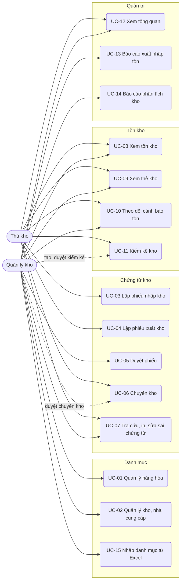
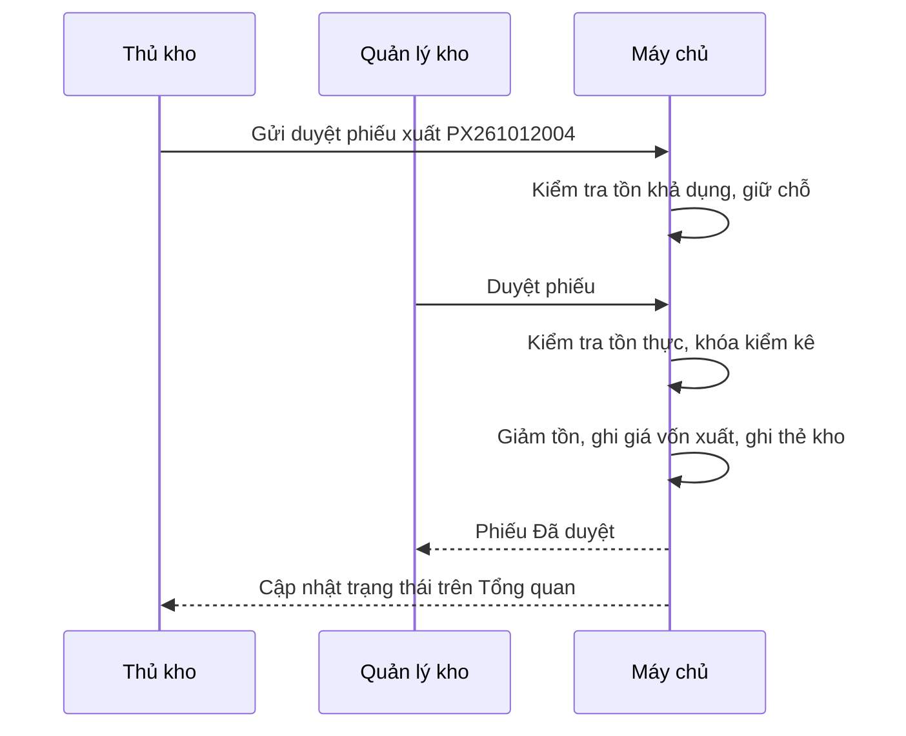

# Đặc tả use case — Quản lý Kho

> Use case phần nền (UC-SYS-01 đến UC-SYS-10): `ZDOCS/03-KIEN-TRUC/USE-CASE-NEN.md`.
> Mã FR, BR, SCR tham chiếu `02-SRS.md`.

---

## 1. Tác nhân

| Tác nhân | Mã vai trò | Use case chính |
| :--- | :--- | :--- |
| Thủ kho | `STAFF` | UC-03, UC-04, UC-06 (lập, nhận), UC-07 (tra cứu, in), UC-08, UC-09, UC-10, UC-11 (đếm), UC-12 (việc cần làm) |
| Quản lý kho | `MANAGER` | UC-01, UC-02, UC-05, UC-06 (duyệt), UC-07, UC-08, UC-09, UC-10, UC-11 (tạo, duyệt), UC-12, UC-13, UC-14, UC-15 |
| Quản trị viên | `ADMIN` | Toàn bộ, cộng phần nền; gán kho cho thủ kho (UC-02) |

---

## 2. Sơ đồ use case

---

## 3. Danh sách use case

| Mã | Tên | Tác nhân chính | Module | Ưu tiên | FR |
| :--- | :--- | :--- | :--- | :---: | :--- |
| UC-01 | Quản lý hàng hóa | Quản lý kho | Danh mục | P1 | FR-07, FR-08, FR-09 |
| UC-02 | Quản lý kho, nhà cung cấp | Quản lý kho | Danh mục | P1 | FR-04, FR-05, FR-06 |
| UC-03 | Lập phiếu nhập kho | Thủ kho | Chứng từ kho | P1 | FR-11, FR-12, FR-17 |
| UC-04 | Lập phiếu xuất kho | Thủ kho | Chứng từ kho | P1 | FR-14, FR-15, FR-17 |
| UC-05 | Duyệt phiếu | Quản lý kho | Chứng từ kho | P1 | FR-13, FR-15, FR-16, FR-18, FR-22 |
| UC-06 | Chuyển kho | Thủ kho, Quản lý kho | Chứng từ kho | P2 | FR-21, FR-22, FR-23 |
| UC-07 | Tra cứu, in, sửa sai chứng từ | Quản lý kho, Thủ kho | Chứng từ kho | P2 | FR-19, FR-20 |
| UC-08 | Xem tồn kho | Quản lý kho, Thủ kho | Tồn kho | P1 | FR-24 |
| UC-09 | Xem thẻ kho | Quản lý kho, Thủ kho | Tồn kho | P1 | FR-25 |
| UC-10 | Theo dõi cảnh báo tồn | Quản lý kho, Thủ kho | Tồn kho | P2 | FR-26 |
| UC-11 | Kiểm kê kho | Thủ kho, Quản lý kho | Tồn kho | P1 | FR-27, FR-28, FR-29, FR-30, FR-31 |
| UC-12 | Xem tổng quan | Quản lý kho, Thủ kho | Quản trị | P1 | FR-01, FR-02, FR-03 |
| UC-13 | Báo cáo xuất nhập tồn | Quản lý kho | Quản trị | P1 | FR-32, FR-33, FR-36 |
| UC-14 | Báo cáo phân tích kho | Quản lý kho | Quản trị | P2 | FR-34, FR-35 |
| UC-15 | Nhập danh mục và tồn đầu kỳ từ Excel | Quản lý kho | Danh mục | P3 | FR-10 |

---

## 4. Đặc tả chi tiết

### UC-01: Quản lý hàng hóa

| Mục | Nội dung |
| :--- | :--- |
| Tác nhân chính | Quản lý kho |
| Mô tả | Thêm, sửa, ngừng mặt hàng, nhóm hàng, đơn vị quy đổi; đặt tồn tối thiểu, tối đa theo kho |
| Ưu tiên | P1 |
| Điều kiện kích hoạt | Có mặt hàng mới, nhà sản xuất đổi quy cách, điều chỉnh ngưỡng tồn |
| Tiền điều kiện | Có quyền `products.create` hoặc `products.update` |
| Hậu điều kiện | Mặt hàng chọn được khi lập phiếu; quét được bằng mã vạch của mọi đơn vị |
| Yêu cầu liên quan | FR-07, FR-08, FR-09, BR-01, BR-02, BR-18, BR-24 |
| Màn hình | SCR-02 |

**Luồng chính (thêm mặt hàng)**

1. Quản lý mở Hàng hóa, tab Mặt hàng; hệ thống hiển thị danh sách gồm mã hàng, tên, nhóm, đơn vị cơ bản, quy cách, tồn từng kho, trạng thái.
2. Bấm "Thêm mặt hàng".
3. Nhập mã hàng, tên, chọn nhóm, nhập đơn vị cơ bản (Chai), mã vạch, quy cách (vd "Chai nhựa 330ml").
4. Thêm đơn vị quy đổi: tên (Thùng 24), hệ số (24), mã vạch thùng.
5. Ở mục "Ngưỡng tồn theo kho", nhập tồn tối thiểu và tối đa cho từng kho (để trống là không cảnh báo).
6. Bấm "Lưu"; hệ thống kiểm tra BR-02, BR-18, mặt hàng xuất hiện với tồn 0 ở mọi kho.

**Luồng thay thế**

- 1a. Nhóm hàng: tab Nhóm hàng, thêm, đổi tên, ngừng sử dụng.
- 1b. Sửa mặt hàng: đổi tên, quy cách, mã vạch, ngưỡng tồn; chứng từ cũ giữ nguyên.
- 1c. Ngừng sử dụng: bật "Ngừng"; mặt hàng không chọn được vào phiếu mới, vẫn có trong báo cáo, thẻ kho.

**Luồng ngoại lệ**

- E1. Mã hàng hoặc mã vạch trùng: báo lỗi tại ô, nêu mặt hàng đang dùng mã đó.
- E2. Tồn tối thiểu lớn hơn hoặc bằng tồn tối đa: báo lỗi tại dòng kho đó.
- E3. Xóa mặt hàng đã có chứng từ, hoặc đổi hệ số của đơn vị đã dùng: hệ thống từ chối, gợi ý "Ngừng" (BR-24).

### UC-02: Quản lý kho, nhà cung cấp

| Mục | Nội dung |
| :--- | :--- |
| Tác nhân chính | Quản lý kho |
| Tác nhân phụ | Quản trị viên (gán kho cho thủ kho) |
| Mô tả | Khai báo kho, thủ kho phụ trách, nhà cung cấp |
| Ưu tiên | P1 |
| Điều kiện kích hoạt | Mở thêm kho, đổi thủ kho, có nhà cung cấp mới |
| Tiền điều kiện | Có quyền `warehouses.create`, `warehouses.assign` hoặc `suppliers.create` |
| Hậu điều kiện | Kho, nhà cung cấp chọn được khi lập phiếu; thủ kho thấy đúng kho được gán |
| Yêu cầu liên quan | FR-04, FR-05, FR-06, BR-02, BR-23, BR-24 |
| Màn hình | SCR-03, SCR-04 |

**Luồng chính (thêm kho, gán thủ kho)**

1. Quản lý mở Kho; hệ thống hiển thị danh sách kho, địa chỉ, thủ kho phụ trách, số mặt hàng còn tồn, giá trị tồn, trạng thái.
2. Bấm "Thêm kho", nhập mã, tên, địa chỉ, số điện thoại.
3. Ở mục "Thủ kho phụ trách", chọn một hoặc nhiều tài khoản vai trò Thủ kho.
4. Bấm "Lưu"; kho xuất hiện trong danh sách chọn kho của các phiếu; thủ kho được gán thấy kho này ở lần tải trang kế tiếp.

**Luồng thay thế**

- 1a. Nhà cung cấp: mở Nhà cung cấp, thêm hoặc sửa mã, tên, mã số thuế, số điện thoại, địa chỉ, người liên hệ; bật "Ngừng giao dịch" khi không mua nữa.
- 3a. Bỏ gán thủ kho: thủ kho đó không còn thấy phiếu, tồn của kho; phiếu nháp do họ lập ở kho đó vẫn giữ, quản lý xem và hủy được.

**Luồng ngoại lệ**

- E1. Mã kho trùng hoặc sai định dạng: báo lỗi tại ô.
- E2. Ngừng hoạt động kho còn tồn hoặc còn phiếu chưa kết thúc: hệ thống từ chối, nêu số mặt hàng còn tồn và số phiếu đang mở (BR-24).

### UC-03: Lập phiếu nhập kho

| Mục | Nội dung |
| :--- | :--- |
| Tác nhân chính | Thủ kho |
| Mô tả | Ghi nhận hàng nhà cung cấp giao hoặc hàng nhập khác, gửi quản lý duyệt |
| Ưu tiên | P1 |
| Điều kiện kích hoạt | Xe hàng nhà cung cấp tới kho, thủ kho đã đếm và đối chiếu hóa đơn |
| Tiền điều kiện | Có quyền `goods-receipts.create`; được gán kho nhận |
| Hậu điều kiện | Phiếu nhập ở trạng thái Chờ duyệt; tồn chưa thay đổi |
| Yêu cầu liên quan | FR-11, FR-12, FR-17, BR-02, BR-05, BR-07, BR-08 |
| Màn hình | SCR-05, SCR-06 |

**Luồng chính**

1. Thủ kho mở Phiếu nhập, bấm "Tạo phiếu nhập".
2. Chọn kho nhận (mặc định kho đầu tiên được gán), loại nhập "Mua hàng", nhà cung cấp, nhập số và ngày hóa đơn của nhà cung cấp.
3. Quét mã thùng trên kiện hàng; hệ thống thêm dòng với đúng mặt hàng và đơn vị Thùng; quét tiếp cùng mã thì số lượng tăng 1.
4. Nhập hoặc sửa số lượng, đơn giá theo hóa đơn; hệ thống tính thành tiền dòng, tổng thành tiền phiếu.
5. Nhập chi phí mua hàng nếu có; hệ thống phân bổ theo BR-08, hiện cột chi phí phân bổ và đơn giá nhập kho từng dòng.
6. Bấm "Gửi duyệt"; hệ thống kiểm tra BR-07, cấp mã `PN` + ngày + số thứ tự, chuyển phiếu sang Chờ duyệt, báo cho quản lý trên Tổng quan.

**Luồng thay thế**

- 2a. Loại "Hàng bán bị trả lại": không bắt buộc nhà cung cấp; đơn giá mặc định bằng giá vốn bình quân của kho (BR-07).
- 2b. Loại "Nhập khác": cho đơn giá 0 với hàng tặng kèm.
- 3a. Hàng không có mã vạch: tìm theo mã hàng hoặc tên không dấu.
- 6a. Chưa xong: bấm "Lưu nháp", mở lại sửa tiếp sau.
- 6b. Gửi nhầm: mở phiếu Chờ duyệt, bấm "Rút lại"; phiếu về Nháp (BR-05).
- 6c. Phiếu bị từ chối: thủ kho thấy lý do trên Tổng quan, mở phiếu sửa rồi gửi lại.

**Luồng ngoại lệ**

- E1. Loại "Mua hàng" chưa chọn nhà cung cấp, số lượng bằng 0, ngày chứng từ sau hôm nay: báo lỗi tại ô, không gửi được.
- E2. Mã quét không tồn tại hoặc thuộc mặt hàng đã ngừng: âm báo lỗi, không thêm dòng.
- E3. Phiếu vượt 200 dòng: báo lỗi, gợi ý tách phiếu.

### UC-04: Lập phiếu xuất kho

| Mục | Nội dung |
| :--- | :--- |
| Tác nhân chính | Thủ kho |
| Mô tả | Lập phiếu xuất bán cho đại lý, trả nhà cung cấp, dùng nội bộ hoặc xuất hủy; gửi duyệt |
| Ưu tiên | P1 |
| Điều kiện kích hoạt | Có đơn hàng cần giao, hàng hỏng cần hủy, hàng trả nhà cung cấp |
| Tiền điều kiện | Có quyền `goods-issues.create`; được gán kho xuất |
| Hậu điều kiện | Phiếu xuất Chờ duyệt; tồn khả dụng giảm, tồn thực chưa đổi |
| Yêu cầu liên quan | FR-14, FR-15, FR-17, BR-03, BR-04, BR-05 |
| Màn hình | SCR-07, SCR-08 |

**Luồng chính**

1. Thủ kho mở Phiếu xuất, bấm "Tạo phiếu xuất".
2. Chọn kho xuất, loại xuất "Xuất bán", nhập người hoặc đơn vị nhận, số đơn hàng tham chiếu.
3. Quét mã hoặc tìm mặt hàng; mỗi dòng hiển thị tồn khả dụng theo cách đọc quy đổi (BR-03).
4. Nhập số lượng; dòng vượt tồn khả dụng tô đỏ ngay.
5. Bấm "Gửi duyệt"; hệ thống kiểm tra BR-04, cấp mã `PX` + ngày + số thứ tự, chuyển phiếu sang Chờ duyệt; số lượng trên phiếu được giữ chỗ khỏi tồn khả dụng.

**Luồng thay thế**

- 2a. Loại "Xuất hủy": bắt buộc ghi lý do (hết hạn, hư hỏng), không cần người nhận.
- 2b. Loại "Trả nhà cung cấp": chọn nhà cung cấp thay cho người nhận.
- 5a. Lưu nháp, rút lại, sửa sau khi bị từ chối: như UC-03 bước 6a–6c. Phiếu Nháp và Từ chối không giữ chỗ tồn.

**Luồng ngoại lệ**

- E1. Số lượng vượt tồn khả dụng: không gửi được, báo "Vượt tồn khả dụng {n} {đơn vị cơ bản}" ở từng dòng (BR-04).
- E2. Loại "Xuất bán" thiếu người nhận: báo lỗi tại ô.

### UC-05: Duyệt phiếu

| Mục | Nội dung |
| :--- | :--- |
| Tác nhân chính | Quản lý kho |
| Mô tả | Duyệt hoặc từ chối phiếu nhập, xuất, chuyển; khi duyệt hệ thống ghi sổ tồn, giá vốn, thẻ kho |
| Ưu tiên | P1 |
| Điều kiện kích hoạt | Có phiếu Chờ duyệt |
| Tiền điều kiện | Có quyền `goods-receipts.approve`, `goods-issues.approve` hoặc `transfers.approve`; không phải người lập phiếu (BR-06) |
| Hậu điều kiện | Phiếu Đã duyệt (hoặc Đang chuyển) và tồn, giá vốn, thẻ kho cập nhật; hoặc phiếu Từ chối kèm lý do |
| Yêu cầu liên quan | FR-13, FR-15, FR-16, FR-18, FR-22, BR-04, BR-06, BR-09, BR-10, BR-11, BR-13, BR-14 |
| Màn hình | SCR-11, SCR-06, SCR-08, SCR-10 |

**Luồng chính**

1. Quản lý mở Phiếu chờ duyệt; hệ thống liệt kê phiếu theo thời gian gửi, có lọc theo loại, kho, người lập.
2. Mở một phiếu; hệ thống hiển thị dòng hàng, số lượng quy đổi, đơn giá, chi phí phân bổ (phiếu nhập) hoặc tồn hiện tại và giá vốn dự kiến (phiếu xuất, chuyển).
3. Quản lý đối chiếu, bấm "Duyệt".
4. Hệ thống kiểm tra lại BR-04 và BR-14, rồi trong một giao dịch: cập nhật tồn, giá trị tồn, giá vốn bình quân (BR-09, BR-10), ghi dòng thẻ kho với thời điểm ghi sổ (BR-11), chuyển phiếu sang Đã duyệt (phiếu chuyển sang Đang chuyển).
5. Phiếu rời khỏi danh sách chờ duyệt; người lập thấy trạng thái mới.

**Luồng thay thế**

- 3a. Từ chối: bấm "Từ chối", nhập lý do tối thiểu 10 ký tự; phiếu sang Từ chối, giải phóng tồn khả dụng đã giữ chỗ.

**Luồng ngoại lệ**

- E1. Quản lý là người lập phiếu: nút "Duyệt" bị khóa, chú thích "Người duyệt phải khác người lập".
- E2. Tồn thực không đủ lúc duyệt: hệ thống từ chối duyệt, nêu dòng thiếu và số thiếu.
- E3. Mặt hàng trên phiếu đang kiểm kê tại kho đó: hệ thống từ chối duyệt, nêu mã phiếu kiểm kê (BR-14).
- E4. Lý do từ chối dưới 10 ký tự: báo lỗi tại ô.

### UC-06: Chuyển kho

| Mục | Nội dung |
| :--- | :--- |
| Tác nhân chính | Thủ kho (kho đi lập, kho đến nhận) |
| Tác nhân phụ | Quản lý kho (duyệt) |
| Mô tả | Chuyển hàng giữa hai kho, ghi nhận hao hụt khi nhận thiếu |
| Ưu tiên | P2 |
| Yêu cầu liên quan | FR-21, FR-22, FR-23, BR-03, BR-04, BR-09, BR-13, BR-23 |
| Màn hình | SCR-09, SCR-10 |

**Luồng chính**

1. Thủ kho kho đi tạo phiếu chuyển: chọn kho đi, kho đến, quét hàng, nhập số lượng; mỗi dòng hiển thị tồn khả dụng kho đi; bấm "Gửi duyệt".
2. Quản lý duyệt như UC-05; hệ thống trừ tồn kho đi, ghi giá vốn chuyển, phiếu sang "Đang chuyển"; Tổng quan hiện số phiếu đang đi đường.
3. Hàng tới kho đến; thủ kho kho đến mở phiếu, bấm "Xác nhận nhận hàng", nhập số lượng thực nhận từng dòng (mặc định bằng số chuyển).
4. Bấm "Hoàn tất nhận"; hệ thống cộng tồn kho đến theo số thực nhận, tính lại giá vốn kho đến (BR-09), ghi hao hụt cho phần thiếu (BR-13), phiếu sang "Đã nhận".

### UC-07: Tra cứu, in, sửa sai chứng từ

| Mục | Nội dung |
| :--- | :--- |
| Tác nhân chính | Quản lý kho, Thủ kho |
| Mô tả | Tìm phiếu, in phiếu theo mẫu, sửa sai phiếu đã duyệt bằng phiếu ngược |
| Ưu tiên | P2 |
| Yêu cầu liên quan | FR-19, FR-20, BR-12, BR-23 |
| Màn hình | SCR-05, SCR-06, SCR-07, SCR-08 |

**Luồng chính**

1. Người dùng mở danh sách phiếu nhập hoặc phiếu xuất, tìm theo mã hoặc lọc theo kho, loại, trạng thái, người lập, khoảng ngày; thủ kho chỉ thấy phiếu của kho được gán.
2. Mở phiếu, bấm "In"; hệ thống mở bản in A4 theo bố cục mẫu 01-VT hoặc 02-VT, có tổng tiền bằng chữ và chỗ ký người lập, thủ kho, người nhận hoặc người giao, người duyệt.
3. Phát hiện phiếu đã duyệt bị sai, quản lý bấm "Tạo phiếu ngược"; hệ thống tạo phiếu nháp chiều ngược lại với cùng dòng hàng, ghi mã phiếu gốc (BR-12).
4. Quản lý gửi duyệt phiếu ngược; người khác duyệt như UC-05; sau đó lập phiếu đúng nếu cần.

### UC-08: Xem tồn kho

| Mục | Nội dung |
| :--- | :--- |
| Tác nhân chính | Quản lý kho, Thủ kho |
| Mô tả | Xem tồn thực, tồn khả dụng, giá trị tồn theo kho |
| Ưu tiên | P1 |
| Điều kiện kích hoạt | Cần trả lời "còn bao nhiêu hàng", chuẩn bị giao hàng, kiểm tra giá trị tồn |
| Tiền điều kiện | Có quyền `stock-levels.view` |
| Hậu điều kiện | Không thay đổi dữ liệu |
| Yêu cầu liên quan | FR-24, BR-01, BR-03, BR-18, BR-23, BR-25 |
| Màn hình | SCR-12 |

**Luồng chính**

1. Người dùng mở Tồn kho; mặc định chọn tất cả kho (quản lý) hoặc kho đầu tiên được gán (thủ kho).
2. Hệ thống hiển thị mỗi mặt hàng: tồn thực kèm cách đọc quy đổi, số lượng chờ xuất, tồn khả dụng, trạng thái; quản lý thấy thêm giá vốn bình quân và giá trị tồn, dòng tổng giá trị ở đầu bảng.
3. Người dùng chọn kho khác, lọc theo nhóm hoặc trạng thái, tìm theo mã, tên, mã vạch.
4. Bấm số "chờ xuất" để xem danh sách phiếu đang giữ chỗ; bấm tên mặt hàng để mở thẻ kho (UC-09).

**Luồng thay thế**

- 1a. Chọn "Tất cả kho": mỗi mặt hàng một dòng, cột tồn từng kho và cột tổng; giá trị tồn là tổng giá trị các kho.

**Luồng ngoại lệ**

- E1. Thủ kho mở URL lọc kho không được gán: hệ thống bỏ bộ lọc đó, chỉ hiện kho được gán.
- E2. Không có mặt hàng thỏa bộ lọc: hiển thị trạng thái trống, gợi ý bỏ bớt bộ lọc.

### UC-09: Xem thẻ kho

| Mục | Nội dung |
| :--- | :--- |
| Tác nhân chính | Quản lý kho, Thủ kho |
| Mô tả | Truy vết từng lần nhập, xuất của một mặt hàng tại một kho |
| Ưu tiên | P1 |
| Điều kiện kích hoạt | Tồn sổ sách khác thực tế, cần biết hàng đi đâu |
| Tiền điều kiện | Có quyền `stock-levels.view` |
| Hậu điều kiện | Không thay đổi dữ liệu |
| Yêu cầu liên quan | FR-25, BR-11, BR-20, BR-25 |
| Màn hình | SCR-13 |

**Luồng chính**

1. Từ Tồn kho, Hàng hóa hoặc Báo cáo, người dùng bấm vào một mặt hàng; hệ thống mở Thẻ kho, mặc định kho đang chọn, kỳ 30 ngày gần nhất.
2. Hệ thống hiển thị dòng "Tồn đầu kỳ", rồi từng dòng phát sinh xếp theo thời điểm ghi sổ: thời điểm, số phiếu, diễn giải (vd "Xuất bán – Đại lý Tạp hóa Thanh Hương"), nhập, xuất, tồn sau; cuối bảng là tổng nhập, tổng xuất, tồn cuối kỳ (BR-20).
3. Quản lý thấy thêm cột đơn giá, giá trị nhập, giá trị xuất, giá vốn sau.
4. Người dùng bấm số phiếu để mở phiếu gốc.

**Luồng thay thế**

- 1a. Đổi kỳ (Hôm nay, 7 ngày, 30 ngày, Tháng này, Tháng trước, Tùy chọn) hoặc đổi kho; chọn "Mọi kho" để gộp phát sinh của các kho, có cột Kho.
- 4a. Bấm "In thẻ kho": bản in A4 có tên mặt hàng, kho, kỳ, các cột số lượng.

**Luồng ngoại lệ**

- E1. Kỳ không có phát sinh: chỉ hiện tồn đầu kỳ bằng tồn cuối kỳ, ghi chú "Không có phát sinh trong kỳ".
- E2. Khoảng ngày dài hơn 366 ngày: báo lỗi, yêu cầu chọn lại.

### UC-10: Theo dõi cảnh báo tồn

| Mục | Nội dung |
| :--- | :--- |
| Tác nhân chính | Quản lý kho, Thủ kho |
| Mô tả | Phát hiện hàng thiếu, hàng thừa theo kho và xử lý bằng phiếu chuyển hoặc kế hoạch nhập |
| Ưu tiên | P2 |
| Yêu cầu liên quan | FR-26, BR-18, BR-19 |
| Màn hình | SCR-12 |

**Luồng chính**

1. Người dùng mở Tồn kho, tab Cảnh báo; hệ thống liệt kê mặt hàng Hết hàng, Dưới tối thiểu, Vượt tối đa theo từng kho, kèm số lượng đề xuất nhập (BR-19).
2. Với một dòng thiếu, hệ thống hiện các kho khác còn tồn khả dụng của mặt hàng đó.
3. Người dùng bấm "Tạo phiếu chuyển" ở kho còn hàng; hệ thống tạo phiếu chuyển nháp với số lượng đề xuất (hoặc tối đa bằng tồn khả dụng kho đi), mở để chỉnh và gửi duyệt (UC-06).

### UC-11: Kiểm kê kho

| Mục | Nội dung |
| :--- | :--- |
| Tác nhân chính | Thủ kho (đếm) |
| Tác nhân phụ | Quản lý kho (tạo, duyệt) |
| Mô tả | Đếm thực tế, so với sổ sách, điều chỉnh chênh lệch có nguyên nhân |
| Ưu tiên | P1 |
| Điều kiện kích hoạt | Kiểm kê định kỳ cuối tháng, nghi ngờ lệch tồn một nhóm hàng |
| Tiền điều kiện | Có quyền `stocktakes.create`; kho chưa có phiếu kiểm kê chưa kết thúc (BR-14) |
| Hậu điều kiện | Phiếu "Đã cân bằng"; tồn bằng số thực đếm; thẻ kho có dòng điều chỉnh; khóa phát sinh được mở |
| Yêu cầu liên quan | FR-27, FR-28, FR-29, FR-30, FR-31, BR-06, BR-14, BR-15, BR-16, BR-17 |
| Màn hình | SCR-14, SCR-15 |

**Luồng chính**

1. Quản lý mở Kiểm kê, bấm "Tạo phiếu kiểm kê", chọn kho, phạm vi (toàn kho hoặc các nhóm hàng), người đếm.
2. Hệ thống chốt tồn sổ sách và giá vốn của mọi mặt hàng trong phạm vi, cấp mã `KK` + ngày + số thứ tự, phiếu "Đang kiểm", khóa phát sinh của hàng trong phạm vi tại kho đó (BR-14).
3. Thủ kho mở phiếu trên tablet; màn đếm liệt kê mặt hàng theo nhóm, không hiển thị tồn sổ sách (BR-15).
4. Thủ kho quét mã trên từng kiện (mỗi lần quét cộng 1 đơn vị của mã) hoặc gõ số đếm theo thùng và lẻ.
5. Đếm xong, thủ kho bấm "Gửi duyệt"; hệ thống tính chênh lệch số lượng, giá trị từng dòng, tổng thừa, tổng thiếu (BR-16) và hiện cho thủ kho các dòng bắt buộc nguyên nhân.
6. Thủ kho chọn nguyên nhân cho các dòng đó, gửi; phiếu sang "Chờ duyệt".
7. Quản lý mở phiếu, xem bảng chênh lệch sắp theo giá trị, bấm "Duyệt".
8. Hệ thống đặt tồn bằng số thực đếm, giữ giá vốn, ghi dòng "Điều chỉnh kiểm kê" vào thẻ kho, mở khóa, phiếu sang "Đã cân bằng" (BR-17); quản lý bấm "In biên bản" theo bố cục 05-VT.

**Luồng thay thế**

- 1a. Thủ kho tự tạo phiếu kiểm kê cho kho được gán; các bước sau như luồng chính.
- 4a. Đếm nhiều người: mỗi người quét trên máy của mình; số đếm cộng dồn vào cùng phiếu, có cột người đếm cuối.
- 7a. Quản lý nghi ngờ một số dòng: chọn dòng, bấm "Trả lại đếm lại" kèm ghi chú; phiếu về "Đang kiểm", chỉ các dòng đó được đánh dấu cần đếm lại.
- 7b. Hủy phiếu: quản lý bấm "Hủy phiếu"; không điều chỉnh, mở khóa phát sinh.

**Luồng ngoại lệ**

- E1. Kho đã có phiếu kiểm kê chưa kết thúc: không tạo được, hệ thống nêu mã phiếu đó.
- E2. Gửi duyệt khi còn dòng chưa đếm: hệ thống liệt kê dòng chưa đếm; người đếm đếm tiếp hoặc bấm "Điền bằng sổ sách cho dòng chưa đếm" (BR-16).
- E3. Dòng bắt buộc nguyên nhân chưa chọn: không gửi được, dòng tô đỏ.
- E4. Quản lý là người đếm: nút "Duyệt" bị khóa (BR-06).

### UC-12: Xem tổng quan

| Mục | Nội dung |
| :--- | :--- |
| Tác nhân chính | Quản lý kho, Thủ kho |
| Mô tả | Nắm nhanh giá trị tồn, việc chờ duyệt, hàng đang chuyển, hàng cần bổ sung |
| Ưu tiên | P1 |
| Tiền điều kiện | Đã đăng nhập; quản lý có quyền `reports.view` |
| Hậu điều kiện | Không thay đổi dữ liệu |
| Yêu cầu liên quan | FR-01, FR-02, FR-03, BR-13, BR-18, BR-25 |
| Màn hình | SCR-01 |

**Luồng chính**

1. Quản lý đăng nhập; hệ thống mở Tổng quan.
2. Hiển thị thẻ giá trị tồn của từng kho và tổng; thẻ "Phiếu chờ duyệt" chia theo nhập, xuất, chuyển, kiểm kê; thẻ "Đang chuyển" có số phiếu, giá trị, số phiếu trễ; thẻ "Dưới tối thiểu".
3. Hiển thị biểu đồ cột giá trị nhập và xuất theo ngày 30 ngày, bảng top 10 mặt hàng có giá trị xuất lớn nhất.
4. Bấm một thẻ để mở danh sách đã lọc sẵn.

**Luồng thay thế**

- 1a. Thủ kho đăng nhập: Tổng quan hiển thị "Việc cần làm" tại kho được gán: phiếu nháp, phiếu bị từ chối kèm lý do, phiếu chuyển chờ nhận, phiếu kiểm kê đang đếm; không có số giá trị (FR-03).

**Luồng ngoại lệ**

- E1. Chưa có phát sinh trong 30 ngày: biểu đồ hiển thị trạng thái trống; các thẻ tồn vẫn hiển thị.

### UC-13: Báo cáo xuất nhập tồn

| Mục | Nội dung |
| :--- | :--- |
| Tác nhân chính | Quản lý kho |
| Mô tả | Tổng hợp tồn đầu, nhập, xuất, tồn cuối theo kỳ, đối chiếu với kế toán |
| Ưu tiên | P1 |
| Điều kiện kích hoạt | Cuối tháng, cuối quý, khi kế toán cần số liệu |
| Tiền điều kiện | Có quyền `reports.view` |
| Hậu điều kiện | Không thay đổi dữ liệu |
| Yêu cầu liên quan | FR-32, FR-33, FR-36, BR-11, BR-20, BR-21 |
| Màn hình | SCR-16, SCR-13 |

**Luồng chính**

1. Quản lý mở Báo cáo, tab Xuất nhập tồn; mặc định kỳ Tháng này, tất cả kho.
2. Hệ thống hiển thị mỗi mặt hàng một dòng: tồn đầu kỳ, nhập, xuất, tồn cuối kỳ, mỗi cột có số lượng và giá trị; dòng tổng cuối bảng; dòng "Hàng đang chuyển cuối kỳ" nếu có (BR-21).
3. Quản lý chọn kho, kỳ, nhóm hàng; số liệu cập nhật.
4. Bấm vào số nhập hoặc xuất của một dòng; hệ thống mở thẻ kho của mặt hàng đó, cùng kho và kỳ (FR-33).

**Luồng thay thế**

- 2a. Nhóm theo nhóm hàng: bảng gộp theo nhóm, mở rộng để xem từng mặt hàng.
- 4a. Bấm "Xuất Excel": tải file của bảng đang xem (P3).

**Luồng ngoại lệ**

- E1. Khoảng ngày dài hơn 366 ngày: báo lỗi, yêu cầu chọn lại.
- E2. Kỳ không có phát sinh: các cột nhập, xuất bằng 0, tồn cuối bằng tồn đầu.

### UC-14: Báo cáo phân tích kho

| Mục | Nội dung |
| :--- | :--- |
| Tác nhân chính | Quản lý kho |
| Mô tả | Tìm hàng chậm luân chuyển, xem nhập theo nhà cung cấp, xuất theo loại, chênh lệch kiểm kê, hao hụt vận chuyển |
| Ưu tiên | P2 |
| Yêu cầu liên quan | FR-34, FR-35, BR-22 |
| Màn hình | SCR-16 |

**Luồng chính**

1. Quản lý mở Báo cáo, chọn tab Chậm luân chuyển; hệ thống liệt kê mặt hàng theo BR-22, nhóm 30–59, 60–89, từ 90 ngày, sắp theo giá trị tồn giảm dần.
2. Chọn kho, nhóm hàng để lọc; bấm mặt hàng để mở thẻ kho.
3. Chuyển sang tab Nhập theo nhà cung cấp, Xuất theo loại, Chênh lệch kiểm kê, Hao hụt vận chuyển; chọn kỳ và kho để xem.
