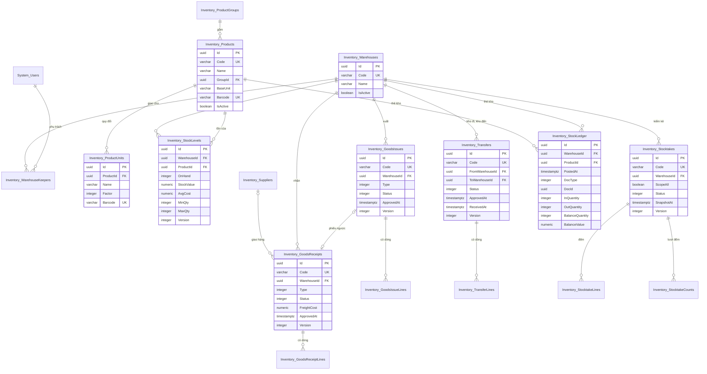

# Thiết kế CSDL — Quản lý Kho

> Database: `WebDemo_RetailQuanLyKho` (Postgres).
> Quy ước chung và nhóm bảng nền `System_*` (tài khoản, vai trò, quyền, cài đặt, nhật ký): xem `ZDOCS/03-KIEN-TRUC/THIET-KE-CSDL-NEN.md`.
> File này chỉ mô tả **bảng nghiệp vụ riêng của dự án**. Area: `Inventory` (kho, nhà cung cấp, hàng hóa, tồn kho, phiếu nhập, xuất, chuyển, kiểm kê, thẻ kho).
> Mã FR, BR, TC tham chiếu `02-SRS.md` và `05-KICH-BAN-KIEM-THU.md`. Hợp đồng API, công thức tính, quy ước FE: `07-DANH-SACH-API.md`.

---

## 1. Sơ đồ

`Inventory_Suppliers`, `Inventory_ProductGroups`, `Inventory_StocktakeCounts` và các bảng dòng phiếu không vẽ cột cho gọn; mô tả đủ ở §4. Thẻ kho (`Inventory_StockLedger`) là sổ ghi một chiều: không sửa, không xóa; tồn, giá trị, giá vốn ở `Inventory_StockLevels` là số dư sau dòng thẻ kho cuối cùng.

---

## 2. Danh sách bảng

| Bảng | Area | Mô tả | Xóa | Dữ liệu mẫu |
| :--- | :--- | :--- | :--- | :---: |
| `Inventory_Warehouses` | Inventory | Kho | Mềm, chỉ khi chưa có chứng từ (BR-24) | 3 |
| `Inventory_WarehouseKeepers` | Inventory | Thủ kho phụ trách kho (bảng nối) | Cứng | 3 |
| `Inventory_Suppliers` | Inventory | Nhà cung cấp | Mềm, chỉ khi chưa có chứng từ | 15 |
| `Inventory_ProductGroups` | Inventory | Nhóm hàng | Mềm, chỉ khi không còn mặt hàng | 10 |
| `Inventory_Products` | Inventory | Mặt hàng | Mềm, chỉ khi chưa có chứng từ | 200 |
| `Inventory_ProductUnits` | Inventory | Đơn vị quy đổi (tối đa 2 mỗi mặt hàng) | Cứng, chỉ khi chưa dùng | 220 |
| `Inventory_StockLevels` | Inventory | Tồn, giá trị, giá vốn, ngưỡng của mặt hàng tại kho | Không xóa | 455 |
| `Inventory_GoodsReceipts` | Inventory | Phiếu nhập | Không xóa, chỉ hủy | 159 |
| `Inventory_GoodsReceiptLines` | Inventory | Dòng phiếu nhập | Theo phiếu | 767 |
| `Inventory_GoodsIssues` | Inventory | Phiếu xuất | Không xóa, chỉ hủy | 398 |
| `Inventory_GoodsIssueLines` | Inventory | Dòng phiếu xuất | Theo phiếu | 2.142 |
| `Inventory_Transfers` | Inventory | Phiếu chuyển kho | Không xóa, chỉ hủy | 46 |
| `Inventory_TransferLines` | Inventory | Dòng phiếu chuyển | Theo phiếu | 300 |
| `Inventory_Stocktakes` | Inventory | Phiếu kiểm kê | Không xóa, chỉ hủy | 3 |
| `Inventory_StocktakeLines` | Inventory | Dòng kiểm kê (tồn sổ sách chốt, số đếm) | Theo phiếu | 298 |
| `Inventory_StocktakeCounts` | Inventory | Nhật ký mỗi lượt gửi số đếm, chống ghi trùng | Theo phiếu | 0 |
| `Inventory_StockLedger` | Inventory | Thẻ kho: mỗi lần tồn thay đổi một dòng | Không xóa | 3.484 |

Số phiếu, dòng phiếu, dòng thẻ kho là số seeder suy ra từ `FE/src/mock/seed/demo-data.json` (§5); chi tiết ở §5.7.

---

## 3. Quy ước chung của dự án

- Mọi bảng có cột chung `Id`, `CreatedAt`, `CreatedBy`, `UpdatedAt`, `UpdatedBy` theo `THIET-KE-CSDL-NEN.md` §1; bảng xóa mềm có thêm `IsDeleted`. Cột unique của bảng xóa mềm dùng index lọc bản ghi chưa xóa (`.IsUnique().WhereNotDeleted()`). Tên bảng theo quy tắc `{Area}_{TenSoNhieu}` với Area `Inventory`; thư mục entity `Domain/Entities/Inventory/{Module}/`.
- **Số lượng** luôn là `integer` theo **đơn vị cơ bản** ở mọi cột tồn, giá vốn, thẻ kho (BR-01). Dòng phiếu lưu thêm đơn vị người dùng chọn: `UnitId`, `UnitName`, `Factor`, `Quantity` (số nguyên > 0) và `BaseQuantity = Quantity × Factor`.
- **Tiền** `numeric(18,2)`, luôn là số nguyên đồng (giá trị có phần lẻ không xuất hiện: mọi phép chia làm tròn tới 1 ₫ theo `07` §3). Giá vốn bình quân là giá của **một đơn vị cơ bản**.
- **Thời gian** lưu UTC. "Ngày" trong mã chứng từ, bộ lọc ngày, kỳ báo cáo, "Trễ" của phiếu chuyển, số ngày chậm luân chuyển tính theo giờ Việt Nam (`VietnamTime`, chép từ demo Quản lý Nhà hàng). Ngày chứng từ gốc (`SourceDocDate`) là `date` (`DateOnly`, trung lập provider).
- Enum lưu `integer`, API trả chuỗi PascalCase không dấu (cùng tên enum C#, bảng tra ở `07` §2).
- Người thao tác được chụp vào bản ghi (`…ById` + `…ByName` là họ tên) để bản in, thẻ kho, báo cáo không phụ thuộc tài khoản. Cột `CreatedBy` của nền là người lập; thêm `CreatedByName`.
- **Khóa lạc quan** (NFR-03): `Version integer` là concurrency token (`IsConcurrencyToken()`) ở `Inventory_GoodsReceipts`, `Inventory_GoodsIssues`, `Inventory_Transfers`, `Inventory_Stocktakes`, `Inventory_StockLevels`. Service tăng 1 ở mỗi thay đổi. Phiếu: client gửi `version`, lệch → 409 `DuLieuCu` (`07` §3.8). Dòng tồn: không gửi qua API; hai giao dịch ghi sổ cùng mặt hàng cùng kho thì giao dịch sau gặp lỗi tranh chấp, service đọc lại và tính lại một lần (không bao giờ ghi đè giá trị cũ).
- **Chống bấm lặp** (idempotent, `07` §3.8): phiếu có `ClientRequestId varchar(64)` unique (cho phép nhiều null) cho lần tạo, và `LastRequestId varchar(64)` cho thao tác gần nhất trên phiếu. Gửi lại cùng mã trả kết quả cũ, không làm lại. Lượt đếm kiểm kê chống trùng bằng `Inventory_StocktakeCounts (StocktakeId, ClientRequestId)` unique.
- **Mã chứng từ** sinh trong service, trong transaction, **lúc gửi duyệt lần đầu** (nháp chưa gửi không có mã, SRS §5.3, BR-02): `PN`, `PX`, `PC` + `yyMMdd` (ngày gửi, giờ Việt Nam) + 3 số; `KK` + `yyMMdd` (ngày tạo) + 2 số; số thứ tự đếm lại từ 1 mỗi ngày, mỗi tiền tố một dãy. Trùng mã do hai request cùng lúc thì index unique báo lỗi, service thử lại một lần. Gửi lại sau khi bị từ chối giữ mã cũ.
- **Ghi sổ** (BR-11): chỉ một chỗ ghi tồn là `StockPostingService` (BE) và `posting.ts` (FE mock), áp đúng thứ tự `07` §3.3–3.7 cho từng dòng theo `LineNo`, trong một transaction cùng việc đổi trạng thái phiếu (NFR-03). Mỗi dòng phiếu ghi sổ sinh một dòng `Inventory_StockLedger` và cập nhật `Inventory_StockLevels`.
- **Nhật ký thao tác**: kho, gán thủ kho, nhà cung cấp, nhóm hàng, mặt hàng, đơn vị quy đổi ghi `System_AuditLogs` như nền. Phiếu, dòng phiếu, lượt đếm, thẻ kho, dòng tồn đánh dấu `IAuditLogExempt` (ghi rất nhiều, bản ghi đã tự lưu người và giờ thao tác). Ngưỡng tồn tối thiểu, tối đa sửa qua mặt hàng nên nhật ký của mặt hàng ghi thêm khóa `levels`.
- Đặt lại dữ liệu demo xóa cứng toàn bộ bảng `Inventory_*` (bảng con trước: thẻ kho, dòng, lượt đếm, phiếu, tồn, đơn vị, mặt hàng, nhóm, nhà cung cấp, thủ kho phụ trách, kho) rồi nạp lại.
- Cài đặt dùng chung lưu ở `System_Settings` (giá trị mẫu trong `FE/src/mock/seed/project.json`; nhãn tiếng Việt ở `FE/src/config/setting-labels.ts`):

| Khóa | Nhóm | Giá trị mẫu | Ghi chú |
| :--- | :--- | :--- | :--- |
| `Brand.AppName` | Thương hiệu | `Quản lý Kho` | Tên sản phẩm trên đầu trang |
| `Brand.LogoUrl` | Thương hiệu | `/logo/logo-mark.svg` | Logo vuông, cũng in góc trái bản in |
| `Brand.PrimaryColor` | Thương hiệu | `#4338CA` | Chàm đậm, chữ trắng tương phản 7,9:1 |
| `Store.Name` | Đơn vị in trên chứng từ | `Công ty TNHH Phân phối Tân Lộc Phát` | Doanh nghiệp mẫu hư cấu; "Đơn vị:" trên phiếu 01-VT, 02-VT, 05-VT |
| `Store.Address` | Đơn vị in trên chứng từ | `18 Đường số 7, phường Tân Tạo, TP. Hồ Chí Minh` | "Địa chỉ:" trên phiếu |
| `Store.Phone` | Đơn vị in trên chứng từ | `028 3754 2618` | |
| `Store.TaxCode` | Đơn vị in trên chứng từ | `0318246975` | 10 hoặc 13 chữ số |
| `Store.DirectorName` | Đơn vị in trên chứng từ | `Võ Thành Lộc` | Dưới chữ ký "Giám đốc" |
| `Store.ChiefAccountantName` | Đơn vị in trên chứng từ | `Ngô Thị Thu Trang` | Dưới chữ ký "Kế toán trưởng" |

  `Company.*` của nền là thông tin liên hệ của bên làm demo (chân trang), không in lên chứng từ kho. Hằng số nghiệp vụ là hằng trong code (`InventoryRules`, BE và FE cùng giá trị): tối đa 200 dòng mỗi phiếu (BR-07, NFR-02); hệ số quy đổi 2–10.000 (BR-01); tối đa 2 đơn vị quy đổi (FR-07); phiếu chuyển "Trễ" khi đang chuyển quá 3 ngày (BR-13); lý do từ chối tối thiểu 10 ký tự (BR-06); dòng kiểm kê bắt buộc nguyên nhân khi giá trị chênh từ 1.000.000 ₫ hoặc chênh từ 5% sổ sách (BR-16); khoảng ngày tối đa 366 ngày (UC-09 E2).
- **Ảnh hàng hóa mẫu** không vẽ từng mặt hàng: mỗi mặt hàng trỏ tới một **kiểu hàng** (`imageKinds` trong seed, 25 kiểu: chai nhựa, lon, hộp giấy, gói mì, bao gạo, can nhựa…), `ImageUrl = /seed/products/{kiểu}.webp`, FE phục vụ từ `FE/public/seed/products/`. Thiếu ảnh thì FE hiện ô màu theo `Inventory_ProductGroups.Color` kèm chữ viết tắt. Demo không có tải ảnh mặt hàng (SRS không yêu cầu).

---

## 4. Mô tả bảng

### `Inventory_Warehouses`: kho

| Cột | Kiểu | Ràng buộc | Ghi chú |
| :--- | :--- | :--- | :--- |
| `Code` | `varchar(10)` | unique trong bản ghi chưa xóa, `^[A-Z0-9]{2,10}$` | `KTONG`; trùng → 409 (UC-02 E1) |
| `Name` | `varchar(100)` | bắt buộc | `Kho tổng Bình Tân` |
| `Address` | `varchar(250)` | | Địa điểm in trên phiếu |
| `Phone` | `varchar(20)` | | |
| `IsActive` | `boolean` | mặc định 1 | Ngừng hoạt động: chặn khi còn tồn > 0 hoặc còn phiếu chưa kết thúc (BR-24, TC-05); kho ngừng không chọn được vào phiếu mới |
| `SortOrder` | `integer` | | Thứ tự trong ô chọn kho; thêm mới = max + 10 |
| `IsDeleted` | `boolean` | mặc định 0 | Xóa chỉ khi chưa có `Inventory_StockLevels` có phát sinh và chưa có phiếu |

"Phiếu chưa kết thúc" của kho: phiếu nhập, xuất của kho ở `Nhap`, `ChoDuyet`, `TuChoi`; phiếu chuyển có kho đi hoặc kho đến là kho này ở `Nhap`, `ChoDuyet`, `TuChoi`, `DangChuyen`; phiếu kiểm kê `DangKiem`, `ChoDuyet`.

### `Inventory_WarehouseKeepers`: thủ kho phụ trách

Bảng nối thuần, không có `Id` và cột chung. Khóa ghép (`WarehouseId`, `UserId`), cả hai FK xóa theo; index `UserId`. Chỉ gán tài khoản có vai trò `STAFF` (FR-05). Một tài khoản phụ trách nhiều kho, một kho nhiều thủ kho. Ghi nhật ký vào khóa `keepers` của bản ghi kho.

**Phạm vi kho** (BR-23, áp ở mọi API): người có quyền `warehouses.assign` (Quản lý, Quản trị viên) thấy và thao tác mọi kho; người không có quyền này chỉ thấy kho có dòng trong bảng này với `UserId` của mình (`IWarehouseScope`, `07` §2 "Phạm vi kho").

### `Inventory_Suppliers`: nhà cung cấp

| Cột | Kiểu | Ràng buộc | Ghi chú |
| :--- | :--- | :--- | :--- |
| `Code` | `varchar(10)` | unique trong bản ghi chưa xóa, `^NCC\d{3}$` | Bỏ trống khi tạo → BE cấp `NCC` + số lớn nhất + 1 (SRS §5.3) |
| `Name` | `varchar(200)` | bắt buộc | |
| `TaxCode` | `varchar(14)` | `^\d{10}(-?\d{3})?$` | |
| `Phone` | `varchar(20)` | | |
| `Address` | `varchar(250)` | | |
| `ContactName` | `varchar(100)` | | Người liên hệ |
| `IsActive` | `boolean` | mặc định 1 | "Ngừng giao dịch": không chọn được vào phiếu mới |
| `IsDeleted` | `boolean` | mặc định 0 | Chỉ khi chưa có phiếu nhập, xuất tham chiếu |

### `Inventory_ProductGroups`: nhóm hàng

| Cột | Kiểu | Ràng buộc | Ghi chú |
| :--- | :--- | :--- | :--- |
| `Code` | `varchar(20)` | unique trong bản ghi chưa xóa, `^[A-Z0-9]{2,20}$` | `GIAVI`; seed tham chiếu |
| `Name` | `varchar(100)` | bắt buộc | `Dầu ăn, gia vị` |
| `Color` | `varchar(7)` | `#RRGGBB` | Chấm màu ở danh sách, nền ô ảnh mặc định |
| `IsActive` | `boolean` | mặc định 1 | Nhóm ngừng không chọn được cho mặt hàng mới, vẫn lọc được |
| `SortOrder` | `integer` | | Thứ tự hiển thị, thứ tự dòng trên phiếu kiểm kê |
| `IsDeleted` | `boolean` | mặc định 0 | Chỉ khi không còn mặt hàng chưa xóa |

### `Inventory_Products`: mặt hàng

| Cột | Kiểu | Ràng buộc | Ghi chú |
| :--- | :--- | :--- | :--- |
| `Code` | `varchar(20)` | unique trong bản ghi chưa xóa, `^[A-Z0-9-]{3,20}$` | `NTL-330`; trùng → 409 (TC-02) |
| `Name` | `varchar(200)` | bắt buộc | Tên chung, không nhãn hiệu thật trong dữ liệu mẫu |
| `SearchText` | `varchar(400)` | | Chữ thường không dấu của mã, tên, mọi mã vạch, ghép bằng khoảng trắng; tìm "gõ không dấu" trên mọi provider (FR-09). Cập nhật mỗi lần lưu mặt hàng |
| `GroupId` | `uuid` | FK `Inventory_ProductGroups`, chặn xóa, có index | |
| `BaseUnit` | `varchar(20)` | bắt buộc | `Chai`, `Túi`, `Can`… |
| `Barcode` | `varchar(14)` | unique khi khác null, `^\d{8,14}$` | Mã của đơn vị cơ bản |
| `Spec` | `varchar(100)` | | Quy cách: `Chai nhựa 330ml` |
| `ImageUrl` | `varchar(500)` | | `/seed/products/chai-nhua.webp` |
| `IsActive` | `boolean` | mặc định 1 | "Ngừng sử dụng": không chọn, không quét được vào phiếu mới (UC-03 E2), vẫn có ở thẻ kho, báo cáo |
| `IsDeleted` | `boolean` | mặc định 0 | Chỉ khi chưa có dòng phiếu, dòng thẻ kho (BR-24) |

**Mã vạch không trùng giữa mọi đơn vị của mọi mặt hàng** (BR-02): kiểm trong service trên cả `Inventory_Products.Barcode` và `Inventory_ProductUnits.Barcode` (hai index unique riêng chỉ bắt trùng trong một bảng). Trùng → 409 kèm tên mặt hàng và đơn vị đang dùng (TC-02).

### `Inventory_ProductUnits`: đơn vị quy đổi

| Cột | Kiểu | Ràng buộc | Ghi chú |
| :--- | :--- | :--- | :--- |
| `ProductId` | `uuid` | FK `Inventory_Products`, xóa theo, index `(ProductId, SortOrder)` | |
| `Name` | `varchar(30)` | bắt buộc, không trùng trong mặt hàng | `Thùng 24`, `Lốc 6` |
| `Factor` | `integer` | 2–10.000, không trùng trong mặt hàng | Số đơn vị cơ bản (BR-01); đã có trong chứng từ thì không đổi được (TC-03) |
| `Barcode` | `varchar(14)` | unique khi khác null, `^\d{8,14}$` | Mã thùng thường là GTIN-14 |
| `SortOrder` | `integer` | 1 hoặc 2 | Theo hệ số tăng dần |

Tối đa 2 dòng mỗi mặt hàng (FR-07). "Đã dùng" = có dòng phiếu (`UnitId`) hoặc lượt đếm trỏ tới; đơn vị đã dùng không xóa, không đổi hệ số. Bảng con của mặt hàng nên không có `IsDeleted`; sửa qua `PUT` mặt hàng.

### `Inventory_StockLevels`: tồn của mặt hàng tại kho

| Cột | Kiểu | Ràng buộc | Ghi chú |
| :--- | :--- | :--- | :--- |
| `WarehouseId` | `uuid` | FK, unique `(WarehouseId, ProductId)` | |
| `ProductId` | `uuid` | FK, có index | |
| `OnHand` | `integer` | ≥ 0 | Tồn thực (BR-04: không bao giờ âm) |
| `StockValue` | `numeric(18,2)` | ≥ 0 | Giá trị tồn, cộng trừ theo từng nghiệp vụ (BR-10); `OnHand = 0` thì luôn 0 |
| `AvgCost` | `numeric(18,2)` | | Giá vốn bình quân một đơn vị cơ bản (BR-09); giữ giá cuối khi tồn về 0 |
| `MinQty` | `integer` | null, ≥ 0 | Tồn tối thiểu theo đơn vị cơ bản; null = không cảnh báo thiếu (BR-18) |
| `MaxQty` | `integer` | null, > `MinQty` | Tồn tối đa; null = không cảnh báo thừa, không đề xuất (BR-19) |
| `LastIssueAt` | `timestamptz` | null | Lần xuất gần nhất tính chậm luân chuyển: duyệt phiếu Xuất bán, Dùng nội bộ, duyệt phiếu chuyển đi (BR-22) |
| `FirstReceiptAt` | `timestamptz` | null | Lần ghi nhập đầu tiên (phiếu nhập, chuyển đến, kiểm kê thừa) |
| `Version` | `integer` | concurrency token | NFR-03 |

Dòng được tạo khi mặt hàng có ngưỡng tại kho (lưu mặt hàng) hoặc lần đầu có phát sinh tại kho; không xóa. Mặt hàng chưa có dòng tại kho coi như tồn 0, không ngưỡng. **Không lưu** tồn khả dụng, số chờ xuất, trạng thái: API tính khi đọc (`07` §3.6, §3.9).

### `Inventory_GoodsReceipts`: phiếu nhập

| Cột | Kiểu | Ràng buộc | Ghi chú |
| :--- | :--- | :--- | :--- |
| `Code` | `varchar(20)` | unique khi khác null | `PN261015001`; cấp lúc gửi duyệt lần đầu |
| `WarehouseId` | `uuid` | FK, index `(WarehouseId, Status)` | Kho nhận |
| `Type` | `integer` | | Enum `ReceiptType` |
| `SupplierId` | `uuid` | null, FK `Inventory_Suppliers` | Bắt buộc với `MuaHang` (BR-07, TC-09) |
| `DelivererName` | `varchar(150)` | | Họ tên người giao hàng (01-VT); với `HangBanTraLai` là đơn vị trả |
| `SourceDocNo` | `varchar(30)` | | Số hóa đơn, chứng từ gốc |
| `SourceDocDate` | `date` | ≤ hôm nay (giờ Việt Nam) | BR-07, TC-09 |
| `Note` | `varchar(500)` | | |
| `FreightCost` | `numeric(18,2)` | ≥ 0, mặc định 0 | Chi phí mua hàng (FR-12) |
| `TotalAmount` | `numeric(18,2)` | | Σ `Amount` dòng |
| `TotalValue` | `numeric(18,2)` | | Σ `Value` dòng = `TotalAmount + FreightCost` |
| `Status` | `integer` | index `(Status, SubmittedAt)` | Enum `DocStatus` |
| `CreatedByName` | `varchar(150)` | | Người lập (`CreatedBy` của nền là Id) |
| `SubmittedAt` | `timestamptz` | null | Lần gửi duyệt gần nhất; Phiếu chờ duyệt xếp theo cột này |
| `ApprovedById`, `ApprovedByName`, `ApprovedAt` | `uuid`, `varchar(150)`, `timestamptz` | null | `ApprovedAt` là thời điểm ghi sổ (BR-11), có index |
| `RejectedById`, `RejectedByName`, `RejectedAt`, `RejectReason` | …, `varchar(500)` | null | Lần từ chối gần nhất; giữ lại sau khi gửi lại để tra cứu |
| `CancelledById`, `CancelledByName`, `CancelledAt` | | null | |
| `ReversalOfIssueId` | `uuid` | null, FK `Inventory_GoodsIssues`, có index | Phiếu ngược của phiếu xuất (`NhapDieuChinh`, BR-12) |
| `ClientRequestId` | `varchar(64)` | unique, cho phép nhiều null | Tạo phiếu (`07` §3.8) |
| `LastRequestId` | `varchar(64)` | null | Thao tác gần nhất |
| `Version` | `integer` | concurrency token | |

Enum `ReceiptType`: `0 MuaHang` Mua hàng, `1 HangBanTraLai` Hàng bán bị trả lại, `2 NhapKhac` Nhập khác, `3 NhapDieuChinh` Nhập điều chỉnh (chỉ sinh từ "Tạo phiếu ngược").

Enum `DocStatus` (phiếu nhập, phiếu xuất):

| Giá trị | Tên | Hiển thị | Giữ chỗ tồn khả dụng (phiếu xuất) |
| :---: | :--- | :--- | :---: |
| 0 | `Nhap` | Nháp | Không |
| 1 | `ChoDuyet` | Chờ duyệt | Có (BR-03) |
| 2 | `TuChoi` | Từ chối | Không |
| 3 | `DaDuyet` | Đã duyệt | — (đã ghi sổ) |
| 4 | `DaHuy` | Đã hủy | Không |

"Phiếu ngược đã có" của một phiếu không lưu ở phiếu gốc: tra phiếu chiều ngược lại có `ReversalOf…Id` = phiếu gốc và `Status <> DaHuy` (mỗi phiếu gốc tối đa một, BR-12). Tạo phiếu ngược tăng `Version` của phiếu gốc để hai người bấm cùng lúc không tạo được hai phiếu.

### `Inventory_GoodsReceiptLines`: dòng phiếu nhập

| Cột | Kiểu | Ràng buộc | Ghi chú |
| :--- | :--- | :--- | :--- |
| `ReceiptId` | `uuid` | FK, xóa theo, index `(ReceiptId, LineNo)` | |
| `LineNo` | `integer` | 1…200 | Thứ tự ghi sổ (BR-09: nhiều dòng cùng mặt hàng tính lần lượt) |
| `ProductId` | `uuid` | FK, chặn xóa, có index | |
| `ProductCode`, `ProductName`, `BaseUnit` | `varchar(20)`, `varchar(200)`, `varchar(20)` | | Chụp lúc lưu dòng (SRS §5.1) |
| `UnitId` | `uuid` | null, FK `Inventory_ProductUnits`, chặn xóa | null = đơn vị cơ bản |
| `UnitName` | `varchar(30)` | | Chụp; đơn vị cơ bản thì bằng `BaseUnit` |
| `Factor` | `integer` | ≥ 1 | Chụp |
| `Quantity` | `integer` | > 0 | Theo đơn vị đã chọn |
| `BaseQuantity` | `integer` | | `Quantity × Factor` |
| `UnitPrice` | `numeric(18,2)` | ≥ 0 | Theo đơn vị đã chọn, chưa thuế GTGT (BR-07) |
| `Amount` | `numeric(18,2)` | | `Quantity × UnitPrice` |
| `AllocatedCost` | `numeric(18,2)` | | Phân bổ BR-08, tính lại mỗi lần lưu |
| `Value` | `numeric(18,2)` | | `Amount + AllocatedCost` = giá trị nhập kho |

### `Inventory_GoodsIssues`: phiếu xuất

| Cột | Kiểu | Ràng buộc | Ghi chú |
| :--- | :--- | :--- | :--- |
| `Code` | `varchar(20)` | unique khi khác null | `PX261015004` |
| `WarehouseId` | `uuid` | FK, index `(WarehouseId, Status)` | Kho xuất |
| `Type` | `integer` | | Enum `IssueType` |
| `RecipientName` | `varchar(150)` | | Bắt buộc với `XuatBan` (TC-12) |
| `SupplierId` | `uuid` | null, FK | Bắt buộc với `TraNhaCungCap` (UC-04 2b) |
| `OrderRef` | `varchar(30)` | | Số đơn hàng tham chiếu |
| `Reason` | `varchar(300)` | | Bắt buộc với `XuatHuy` (TC-12), `XuatDieuChinh`; tùy chọn với loại khác |
| `TotalValue` | `numeric(18,2)` | null | Σ `Value` dòng, có khi đã duyệt |
| `Status` | `integer` | index `(Status, SubmittedAt)` | Enum `DocStatus` |
| `CreatedByName`, `SubmittedAt`, `Approved…`, `Rejected…`, `Cancelled…` | | | Như phiếu nhập |
| `ReversalOfReceiptId` | `uuid` | null, FK `Inventory_GoodsReceipts`, có index | Phiếu ngược của phiếu nhập (`XuatDieuChinh`) |
| `ClientRequestId`, `LastRequestId`, `Version` | | | Như phiếu nhập |

Enum `IssueType`: `0 XuatBan` Xuất bán, `1 TraNhaCungCap` Trả nhà cung cấp, `2 DungNoiBo` Dùng nội bộ, `3 XuatHuy` Xuất hủy, `4 XuatDieuChinh` Xuất điều chỉnh (chỉ sinh từ "Tạo phiếu ngược").

### `Inventory_GoodsIssueLines`: dòng phiếu xuất

Như dòng phiếu nhập trừ phần giá: `IssueId`, `LineNo`, `ProductId`, `ProductCode`, `ProductName`, `BaseUnit`, `UnitId`, `UnitName`, `Factor`, `Quantity`, `BaseQuantity`, và:

| Cột | Kiểu | Ràng buộc | Ghi chú |
| :--- | :--- | :--- | :--- |
| `UnitCost` | `numeric(18,2)` | null | Giá vốn bình quân của kho tại thời điểm duyệt, một đơn vị cơ bản (FR-16) |
| `Value` | `numeric(18,2)` | null | BR-10: `BaseQuantity × UnitCost`, xuất hết thì bằng giá trị tồn còn lại |

### `Inventory_Transfers`: phiếu chuyển kho

| Cột | Kiểu | Ràng buộc | Ghi chú |
| :--- | :--- | :--- | :--- |
| `Code` | `varchar(20)` | unique khi khác null | `PC261015001` |
| `FromWarehouseId` | `uuid` | FK, index `(FromWarehouseId, Status)` | Kho đi |
| `ToWarehouseId` | `uuid` | FK, index `(ToWarehouseId, Status)`, khác kho đi | Kho đến (TC-19) |
| `Note` | `varchar(500)` | | |
| `Status` | `integer` | index `(Status, ApprovedAt)` | Enum `TransferStatus` |
| `CreatedByName`, `SubmittedAt`, `Approved…`, `Rejected…`, `Cancelled…` | | | Như phiếu nhập; `ApprovedAt` là thời điểm ghi sổ kho đi |
| `ReceivedById`, `ReceivedByName`, `ReceivedAt` | | null | `ReceivedAt` là thời điểm ghi sổ kho đến |
| `TotalValue` | `numeric(18,2)` | null | Σ `Value` dòng (giá trị hàng trên xe), có từ khi duyệt |
| `ShortageValue` | `numeric(18,2)` | null | Σ `ShortageValue` dòng, có khi đã nhận |
| `ClientRequestId`, `LastRequestId`, `Version` | | | |

Enum `TransferStatus`: `0 Nhap` Nháp, `1 ChoDuyet` Chờ duyệt (giữ chỗ tồn khả dụng kho đi), `2 TuChoi` Từ chối, `3 DangChuyen` Đang chuyển, `4 DaNhan` Đã nhận, `5 DaHuy` Đã hủy. "Trễ" không lưu: `DangChuyen` và bây giờ − `ApprovedAt` > 3 ngày (BR-13).

### `Inventory_TransferLines`: dòng phiếu chuyển

`TransferId`, `LineNo`, `ProductId`, `ProductCode`, `ProductName`, `BaseUnit`, `UnitId`, `UnitName`, `Factor`, `Quantity`, `BaseQuantity` như dòng phiếu xuất, và:

| Cột | Kiểu | Ràng buộc | Ghi chú |
| :--- | :--- | :--- | :--- |
| `UnitCost` | `numeric(18,2)` | null | Giá vốn chuyển = giá vốn bình quân kho đi lúc duyệt (BR-13) |
| `Value` | `numeric(18,2)` | null | Giá trị chuyển (BR-10 khi xuất hết) |
| `ReceivedBaseQuantity` | `integer` | null, 0…`BaseQuantity` | Số thực nhận (TC-19) |
| `ShortageQuantity` | `integer` | null | `BaseQuantity − ReceivedBaseQuantity` |
| `ShortageValue` | `numeric(18,2)` | null | `ShortageQuantity × UnitCost` (hao hụt vận chuyển) |

### `Inventory_Stocktakes`: phiếu kiểm kê

| Cột | Kiểu | Ràng buộc | Ghi chú |
| :--- | :--- | :--- | :--- |
| `Code` | `varchar(20)` | unique | `KK26101501`, cấp lúc tạo |
| `WarehouseId` | `uuid` | FK, index `(WarehouseId, Status)` | Tối đa một phiếu `DangKiem`/`ChoDuyet` mỗi kho (BR-14): kiểm trong service khi tạo, trong transaction, kèm tăng `Version` của dòng kho… (khóa bằng `SELECT … FOR UPDATE` trên dòng kho với Postgres) |
| `ScopeAll` | `boolean` | | Toàn kho |
| `ScopeGroupIds` | `text` | | Mảng JSON Id nhóm hàng khi không toàn kho, ≥ 1 |
| `Status` | `integer` | | Enum `StocktakeStatus` |
| `SnapshotAt` | `timestamptz` | | Thời điểm chốt sổ sách = lúc tạo |
| `CreatedByName` | `varchar(150)` | | Người tạo (quản lý hoặc thủ kho, UC-11 1a) |
| `CounterId`, `CounterName` | `uuid`, `varchar(150)` | FK `System_Users` | Người đếm chính; người duyệt phải khác người này (BR-06) |
| `SubmittedById`, `SubmittedByName`, `SubmittedAt` | | null | |
| `ApprovedById`, `ApprovedByName`, `ApprovedAt` | | null | `ApprovedAt` là thời điểm ghi sổ điều chỉnh |
| `CancelledById`, `CancelledByName`, `CancelledAt` | | null | |
| `Note` | `varchar(500)` | | |
| `ReturnNote` | `varchar(500)` | | Ghi chú lần "Trả lại đếm lại" gần nhất |
| `SurplusValue`, `ShortageValue` | `numeric(18,2)` | null | Tổng thừa, tổng thiếu (số dương), tính khi gửi duyệt và khi duyệt |
| `ClientRequestId`, `LastRequestId`, `Version` | | | |

Enum `StocktakeStatus`: `0 DangKiem` Đang kiểm, `1 ChoDuyet` Chờ duyệt, `2 DaCanBang` Đã cân bằng, `3 DaHuy` Đã hủy.

**Khóa phát sinh** (BR-14) không lưu cờ riêng: mặt hàng P tại kho W bị khóa khi có phiếu kiểm kê của W ở `DangKiem` hoặc `ChoDuyet` mà (`ScopeAll` hoặc nhóm **hiện tại** của P thuộc `ScopeGroupIds`, hoặc P có dòng trong phiếu). Kiểm khi duyệt phiếu nhập, xuất, duyệt phiếu chuyển (kho đi) và khi xác nhận nhận (kho đến).

### `Inventory_StocktakeLines`: dòng kiểm kê

| Cột | Kiểu | Ràng buộc | Ghi chú |
| :--- | :--- | :--- | :--- |
| `StocktakeId` | `uuid` | FK, xóa theo, unique `(StocktakeId, ProductId)` | |
| `ProductId`, `ProductCode`, `ProductName` | | | Chụp |
| `GroupId`, `GroupName` | `uuid`, `varchar(100)` | | Nhóm lúc chốt, để màn đếm gom theo nhóm |
| `BaseUnit` | `varchar(20)` | | |
| `BookQuantity` | `integer` | | Tồn sổ sách chốt lúc tạo (0 với dòng thêm ngoài danh sách) |
| `BookCost` | `numeric(18,2)` | | Giá vốn bình quân lúc chốt (dòng thêm: giá vốn hiện tại của kho, chưa có thì 0) |
| `CountedQuantity` | `integer` | null, ≥ 0 | null = chưa đếm |
| `Difference` | `integer` | null | `CountedQuantity − BookQuantity` |
| `DifferenceValue` | `numeric(18,2)` | null | BR-16, quy tắc về 0 ở `07` §3.7 |
| `ReasonRequired` | `boolean` | | BR-16, tính lại mỗi lần đổi số đếm |
| `Reason` | `integer` | null | Enum `VarianceReason` |
| `ReasonNote` | `varchar(300)` | | Bắt buộc khi `Khac` |
| `NeedsRecount` | `boolean` | mặc định 0 | Quản lý trả lại dòng này (UC-11 7a); xóa cờ khi đếm lại dòng |
| `RecountNote` | `varchar(300)` | | |
| `IsAdded` | `boolean` | mặc định 0 | Người đếm thêm mặt hàng ngoài danh sách (BR-14) |
| `LastCountedById`, `LastCountedByName`, `LastCountedAt` | | null | Cột "người đếm cuối" (UC-11 4a) |
| `SortOrder` | `integer` | | (thứ tự nhóm, mã hàng); dòng thêm nối cuối |

Enum `VarianceReason`: `0 HuHong` Hư hỏng, `1 MatMat` Mất mát, `2 NhapXuatChuaLapPhieu` Nhập xuất chưa lập phiếu, `3 NhamMaHang` Nhầm mã hàng, `4 Khac` Khác (kèm ghi chú).

### `Inventory_StocktakeCounts`: lượt gửi số đếm

| Cột | Kiểu | Ràng buộc | Ghi chú |
| :--- | :--- | :--- | :--- |
| `StocktakeId` | `uuid` | FK, xóa theo, unique `(StocktakeId, ClientRequestId)` | |
| `ClientRequestId` | `varchar(64)` | bắt buộc | Máy đếm gửi lại cùng mã (mất mạng giữa chừng) thì không cộng lần hai |
| `Entries` | `text` | | Mảng JSON `CountEntry[]` đã gửi (`07` §2.9) |
| `CountedById`, `CountedByName` | | | |
| `CreatedAt` | `timestamptz` | | Giờ gửi (cột chung) |

### `Inventory_StockLedger`: thẻ kho

| Cột | Kiểu | Ràng buộc | Ghi chú |
| :--- | :--- | :--- | :--- |
| `WarehouseId` | `uuid` | FK, index `(WarehouseId, ProductId, PostedAt)` | |
| `ProductId` | `uuid` | FK, index `(ProductId, PostedAt)` | |
| `PostedAt` | `timestamptz` | bắt buộc, index `(PostedAt)` | Thời điểm ghi sổ (BR-11) |
| `Seq` | `bigint` | | Thứ tự trong cùng một lần ghi sổ = `LineNo` của dòng phiếu; thẻ kho xếp `(PostedAt, DocCode, Seq)` |
| `DocType` | `integer` | | Enum `LedgerDocType` |
| `DocId` | `uuid` | index | Phiếu nhập, xuất, chuyển hoặc kiểm kê |
| `DocCode` | `varchar(20)` | | Chụp mã phiếu |
| `DocLineId` | `uuid` | | Dòng phiếu sinh ra dòng thẻ kho |
| `SubType` | `integer` | null | `ReceiptType` hoặc `IssueType` của phiếu, để báo cáo xuất theo loại, tìm lần xuất |
| `CounterpartWarehouseId` | `uuid` | null | Kho kia của phiếu chuyển |
| `Description` | `varchar(300)` | | Diễn giải chụp lúc ghi (`07` §3.10) |
| `InQuantity`, `OutQuantity` | `integer` | ≥ 0, đúng một cột > 0 | Theo đơn vị cơ bản; kiểm kê thừa ghi nhập, thiếu ghi xuất (BR-17) |
| `BalanceQuantity` | `integer` | | Tồn sau dòng này tại kho |
| `UnitCost` | `numeric(18,2)` | | Đơn giá một đơn vị cơ bản: nhập = `Value ÷ BaseQuantity` làm tròn; xuất, chuyển, kiểm kê = giá vốn dùng để tính |
| `InValue`, `OutValue` | `numeric(18,2)` | | Giá trị đúng như đã cộng trừ vào `StockValue` |
| `BalanceValue` | `numeric(18,2)` | | `StockValue` sau dòng |
| `AvgCostAfter` | `numeric(18,2)` | | `AvgCost` sau dòng |

Enum `LedgerDocType`: `0 PhieuNhap`, `1 PhieuXuat`, `2 ChuyenDi`, `3 ChuyenDen`, `4 KiemKe`. Hao hụt vận chuyển không có dòng thẻ kho (kho đi đã trừ đủ, kho đến chỉ cộng số thực nhận); xem ở phiếu chuyển và báo cáo hao hụt.

---

## 5. Dữ liệu mẫu

Nguồn duy nhất: `FE/src/mock/seed/demo-data.json` (FE mock nạp trực tiếp; BE nhúng làm EmbeddedResource, đọc bằng `SeedJson`). Kiểu TypeScript của file: `FE/src/types/inventory-seed.ts`. Phần **viết tay**: `imageKinds`, `productGroups`, `warehouses`, `suppliers`, `recipients`, `products`. Phần **sinh bằng script** `FE/scripts/generate-documents.mjs` (`pnpm seed:documents`, hạt giống `20261015`, chạy lại ra đúng file cũ): `receipts`, `issues`, `transfers`, `stocktakes`. Script đọc phần viết tay, mô phỏng 90 ngày, ghi đè 4 mảng, rồi tự nạp lại file vừa ghi bằng thuật toán §5.5 và dừng nếu sai ràng buộc §5.6. File khoảng 245 KB, mỗi mặt hàng, mỗi chứng từ một dòng (`.prettierignore` đã loại file này).

Doanh nghiệp mẫu (hư cấu): **Công ty TNHH Phân phối Tân Lộc Phát**, phân phối hàng tiêu dùng cho đại lý, tạp hóa ở TP. Hồ Chí Minh và Đồng Nai. Kho: `KTONG` Kho tổng Bình Tân (thủ kho `nhanvien` Lê Hoàng Nam), `KTD` Kho Thủ Đức (`nhanvien`), `KBH` Kho Biên Hòa (`thukho.bh` Phạm Văn Lực). Quản lý kho `quanly` (Trần Thị Mai) duyệt phiếu; phiếu do quản lý lập thì quản trị viên `admin` (Nguyễn Minh Quân) duyệt (BR-06). Tên hàng là tên chung, không nhãn hiệu thật; mã vạch tiền tố `20` (GS1 dành cho mã nội bộ, không trùng sản phẩm thật): đơn vị cơ bản `205810` + 6 số thứ tự + số kiểm tra EAN-13, thùng `1` hoặc `2` + 12 số đầu + số kiểm tra GTIN-14.

### 5.1. Số lượng

| Dữ liệu | Số lượng | Đặc điểm |
| :--- | :---: | :--- |
| Kho | 3 | Đều hoạt động; chưa có `KQ7` (TC-04) |
| Nhà cung cấp | 15 | `NCC001`–`NCC015`; `NCC015` Công ty TNHH Thương mại Quốc Thịnh ngừng giao dịch |
| Nhóm hàng | 10 | Đồ uống (30 mặt hàng), Sữa và sản phẩm từ sữa (18), Bánh kẹo, đồ ăn vặt (24), Mì, phở, cháo ăn liền (16), Dầu ăn, gia vị (22), Gạo, bột, đồ khô (16), Đồ hộp (12), Hóa mỹ phẩm (22), Chăm sóc cá nhân (20), Giấy, đồ dùng gia đình (20) |
| Mặt hàng | 200 | 2 mặt hàng không có đơn vị quy đổi (`NS-19L`, `GAO-25`), 176 có 1, 22 có 2 (220 đơn vị quy đổi); chưa có `SDAC-380` (TC-01) |
| Kiểu ảnh | 25 | `/seed/products/{kiểu}.webp` |
| Dòng tồn (hàng × kho) | 455 | `KTONG` 198, `KTD` 122, `KBH` 135 |
| Phiếu nhập | 159 | 153 đã duyệt (Mua hàng 146, Hàng bán bị trả lại 4, Nhập khác 2, Nhập điều chỉnh 1), 3 chờ duyệt, 1 nháp, 2 đã hủy |
| Phiếu xuất | 398 | 391 đã duyệt (Xuất bán 378, Dùng nội bộ 4, Xuất hủy 5, Trả nhà cung cấp 3, Xuất điều chỉnh 1), 2 chờ duyệt, 1 từ chối, 1 nháp, 3 đã hủy |
| Phiếu chuyển | 46 | 43 đã nhận (6 phiếu nhận thiếu), 2 đang chuyển, 1 chờ duyệt |
| Phiếu kiểm kê | 3 | Đều đã cân bằng |
| Người nhận mẫu | 24 | Đại lý, tạp hóa, siêu thị mini theo khu vực kho (`recipients`), FE gợi ý ở ô Người nhận |

Bảng phân loại phiếu ở trên đếm theo `t` của mọi phiếu đã duyệt; số đúng của lần chạy gần nhất ở §5.7. Tổng phiếu nhập, xuất, chuyển: **603** trong 90 ngày (NFR-07).

### 5.2. Cấu trúc file và cách seeder suy ra trường

Seeder và FE mock suy ra **đúng cùng một cách**:

| Phần | Trường trong file | Suy ra |
| :--- | :--- | :--- |
| `imageKinds[]` | `key`, `name`, `describe` | Không lưu DB; danh sách ảnh cần vẽ |
| `productGroups[]` | `code`, `name`, `color` | `SortOrder = (chỉ số + 1) × 10`, `IsActive = true` |
| `warehouses[]` | `code`, `name`, `address`, `phone`, `keepers` (tên đăng nhập), `active?` | `SortOrder = (chỉ số + 1) × 10`; `Inventory_WarehouseKeepers` theo `keepers` |
| `suppliers[]` | `code`, `name`, `taxCode`, `phone`, `address`, `contactName`, `active?` | `IsActive = active ?? true` |
| `recipients[]` | `name`, `warehouse` | Không lưu DB |
| `products[]` | `code`, `name`, `group`, `unit`, `barcode`, `spec`, `image`, `units: [[tên, hệ số, mã vạch]]`, `stock: { mã kho: [min, max] }`, `supplier`, `tier`, `refCost` | `ImageUrl = "/seed/products/" + image + ".webp"`; `BaseUnit = unit`; `Inventory_ProductUnits.SortOrder` 1, 2; mỗi khóa của `stock` là một dòng `Inventory_StockLevels` với `MinQty`, `MaxQty` (null = không đặt); `supplier`, `tier`, `refCost` chỉ script dùng, seeder bỏ qua |
| `receipts[]`, `issues[]`, `transfers[]`, `stocktakes[]` | Khóa gọn §5.4 | §5.4, §5.5 |

Id ở FE mock cố định qua mỗi lần nạp: `stableId('warehouse', code)`, `stableId('supplier', code)`, `stableId('product-group', code)`, `stableId('product', code)`, `stableId('product-unit', code, sortOrder)`, `stableId('stock-level', mã kho, mã hàng)`, `stableId('goods-receipt', id)`, `stableId('goods-issue', id)`, `stableId('transfer', id)`, `stableId('stocktake', id)`, dòng phiếu `stableId('<loại>-line', id, lineNo)`, dòng thẻ kho `stableId('ledger', id phiếu, kiểu, lineNo)`. Tài khoản tra bằng `userIdOf(username)` của nền. BE sinh `Guid` mới. Mọi tài khoản trong file là tên đăng nhập, seeder tra ra `Id` và họ tên trong `System_Users`.

### 5.3. Thời gian

- `now` = thời điểm nạp seed, **làm tròn xuống tới phút**.
- Mốc thời gian dạng chuỗi `"{n}@HH:mm"`: ngày (hôm nay theo giờ Việt Nam − n ngày), lúc `HH:mm` giờ Việt Nam, đổi sang UTC. `n` từ 1 đến 90.
- Mốc dạng số nguyên âm: `now + N phút` (chỉ chứng từ hôm nay: `-95` là 95 phút trước lúc nạp). Nạp lúc rạng sáng thì vài mốc rơi sang hôm qua; không ảnh hưởng số liệu vì các chứng từ này chưa ghi sổ.
- `inv: [số, n]`: ngày chứng từ gốc = hôm nay − n ngày (giờ Việt Nam), lưu `date`.
- Mọi **thời điểm ghi sổ** trong file (duyệt, nhận hàng chuyển, duyệt kiểm kê) khác nhau từng phút; script kiểm điều này. Nhờ vậy thứ tự ghi sổ chỉ phụ thuộc thời điểm, BE và FE ra cùng giá vốn.
- Không có chứng từ nào ghi sổ hôm nay: mọi số "Hôm nay" của kịch bản kiểm thử (TC-23, TC-33, TC-34) bắt đầu từ trạng thái nạp.

### 5.4. Khóa gọn của chứng từ

Mỗi chứng từ một dòng JSON. Khóa chung (phiếu nhập, xuất, chuyển):

| Khóa | Ý nghĩa | Ví dụ |
| :--- | :--- | :--- |
| `id` | Khóa trong file (`R001`, `I211`, `T044`, `K1`), dùng cho `stableId` và tham chiếu phiếu ngược; không lưu | `"R110"` |
| `by` | Người lập | `"nhanvien"` |
| `cr` | Lúc lập (`CreatedAt`) | `"40@13:05"`, `-140` |
| `sb` | Lúc gửi duyệt lần đầu; vắng = chưa từng gửi | `"40@13:44"` |
| `rj` | `[lúc, người, lý do]` lần từ chối gần nhất | `["13@09:01","quanly","Sai đơn giá so với hóa đơn, kiểm tra lại"]` |
| `sb2` | Lúc gửi lại sau khi bị từ chối | `"13@12:00"` |
| `ap` | `[lúc, người]` duyệt = ghi sổ | `["40@14:02","admin"]` |
| `cx` | `[lúc, người]` hủy | `["70@11:00","nhanvien"]` |

| Phiếu nhập (`receipts[]`) | Ý nghĩa |
| :--- | :--- |
| `w`, `t` | Mã kho, `ReceiptType` |
| `s` | Mã nhà cung cấp (`MuaHang`, `NhapKhac` hàng tặng) |
| `inv` | `[số hóa đơn, n]` |
| `dl` | Người giao hàng |
| `f` | Chi phí mua hàng; vắng = 0 |
| `nt` | Ghi chú |
| `rv` | `id` phiếu xuất gốc khi là phiếu ngược (`NhapDieuChinh`) |
| `ln` | Dòng `[mã hàng, chỉ số đơn vị, số lượng, đơn giá]`; chỉ số đơn vị 0 = đơn vị cơ bản, 1 = `units[0]`, 2 = `units[1]`; đơn giá theo đơn vị đó |

| Phiếu xuất (`issues[]`) | Ý nghĩa |
| :--- | :--- |
| `w`, `t` | Mã kho, `IssueType` |
| `rc` | Người nhận (`XuatBan`) |
| `s` | Mã nhà cung cấp (`TraNhaCungCap`) |
| `or` | Số đơn hàng tham chiếu |
| `why` | Lý do (`XuatHuy`, `DungNoiBo`, `TraNhaCungCap`, `XuatDieuChinh`) |
| `rv` | `id` phiếu nhập gốc khi là phiếu ngược (`XuatDieuChinh`) |
| `ln` | Dòng `[mã hàng, chỉ số đơn vị, số lượng]` |

| Phiếu chuyển (`transfers[]`) | Ý nghĩa |
| :--- | :--- |
| `fw`, `tw` | Kho đi, kho đến |
| `nt` | Ghi chú |
| `ln` | Dòng `[mã hàng, chỉ số đơn vị, số lượng]` |
| `re` | `[lúc, người nhận, [[chỉ số dòng, số thiếu]]?]`; vắng `re` mà có `ap` = đang chuyển; số thiếu theo đơn vị cơ bản |

| Phiếu kiểm kê (`stocktakes[]`) | Ý nghĩa |
| :--- | :--- |
| `id`, `w` | Khóa, mã kho |
| `sc` | `"all"` hoặc mảng mã nhóm hàng |
| `by`, `ct` | Người tạo, người đếm |
| `cr` | Lúc tạo = lúc chốt sổ sách |
| `sb` | Lúc người đếm gửi duyệt |
| `ap` | `[lúc, người]` duyệt |
| `df` | Dòng chênh lệch `[mã hàng, chênh lệch, nguyên nhân?, ghi chú?]`; mặt hàng trong phạm vi không có trong `df` đếm đúng bằng sổ sách |

Suy ra trạng thái (seeder và FE mock):

1. `cx` → `DaHuy`. Phiếu nhập, xuất: `ap` → `DaDuyet`. Phiếu chuyển: `re` → `DaNhan`; `ap` (không `re`) → `DangChuyen`. Còn lại: `rj` mà không `sb2` → `TuChoi`; có `sb` → `ChoDuyet`; không `sb` → `Nhap`. Kiểm kê: `ap` → `DaCanBang`, `cx` → `DaHuy`, `sb` → `ChoDuyet`, còn lại `DangKiem`.
2. `CreatedAt = cr`, `CreatedBy/CreatedByName = by`; `SubmittedAt = sb2 ?? sb`; `Rejected…` từ `rj`; `Approved…` từ `ap`; `Cancelled…` từ `cx`; `Received…` từ `re`. `ClientRequestId`, `LastRequestId` null; `Version = 1`.
3. **Mã chứng từ**: phiếu có `sb` nhận mã `PN`/`PX`/`PC` + `yyMMdd` (ngày của `sb` theo giờ Việt Nam) + số thứ tự 3 chữ số; thứ tự trong ngày theo (`sb`, vị trí trong mảng). Phiếu không có `sb` không có mã. Kiểm kê: `KK` + `yyMMdd` (ngày `cr`) + 2 chữ số. Mã phụ thuộc ngày nạp nên không ghi trong file.
4. Phiếu nhập: `SupplierId` theo `s`; `SourceDocNo`, `SourceDocDate` theo `inv`; `DelivererName = dl`; `Note = nt`; `FreightCost = f ?? 0`; `ReversalOfIssueId` theo `rv`. Dòng: `LineNo` = vị trí + 1, `UnitId`, `UnitName`, `Factor` theo chỉ số đơn vị, `Quantity`, `BaseQuantity`, `UnitPrice`, `Amount`, `AllocatedCost` theo BR-08, `Value`; tổng phiếu.
5. Phiếu xuất: `RecipientName = rc`, `SupplierId` theo `s`, `OrderRef = or`, `Reason = why`, `ReversalOfReceiptId` theo `rv`. Dòng phiếu đã duyệt: `UnitCost`, `Value` lấy từ lần nạp §5.5; phiếu chưa duyệt: null.
6. Phiếu chuyển: dòng có `UnitCost`, `Value` khi đã duyệt; khi đã nhận: `ReceivedBaseQuantity = BaseQuantity − thiếu`, `ShortageQuantity`, `ShortageValue`; tổng phiếu.
7. Kiểm kê: `ScopeAll = (sc == "all")`, `ScopeGroupIds` theo mã nhóm; `CounterId = ct`; `SnapshotAt = cr`. **Dòng** = mặt hàng trong phạm vi có tồn ≠ 0 tại kho ở trạng thái ngay trước sự kiện duyệt của phiếu (bằng trạng thái lúc `cr` vì không có ghi sổ nào ở giữa), xếp theo (thứ tự nhóm, mã hàng). `BookQuantity`, `BookCost` = tồn, giá vốn lúc đó; `CountedQuantity = BookQuantity + chênh` (`df`, vắng = 0); `Difference`, `DifferenceValue`, `ReasonRequired` theo BR-16; `Reason`, `ReasonNote` theo `df`; `LastCountedBy… = ct`, `LastCountedAt = sb`; `SubmittedBy = ct`; `SurplusValue`, `ShortageValue`. Không sinh `Inventory_StocktakeCounts`.

### 5.5. Nạp: ghi sổ lại theo thời gian (thuật toán tham chiếu)

Hàm `replay()` cuối `FE/scripts/generate-documents.mjs` là bản tham chiếu; `features/inventory/mock/` và `DemoDataSeeder` làm giống hệt, **dùng chính hàm ghi sổ của ứng dụng** (FE `posting.ts`, BE `StockPostingService`) để không có hai cách tính:

1. Tạo `Inventory_StockLevels` từ `products[].stock` với `OnHand = 0`, `StockValue = 0`, `AvgCost = 0`.
2. Lập danh sách sự kiện ghi sổ: phiếu nhập có `ap` (nhập), phiếu xuất có `ap` (xuất), phiếu chuyển có `ap` (xuất kho đi), phiếu chuyển có `re` (nhập kho đến), phiếu kiểm kê có `ap` (điều chỉnh). Sắp theo thời điểm tăng dần.
3. Áp từng sự kiện bằng quy tắc `07` §3: phiếu nhập BR-08 rồi BR-09 từng dòng; phiếu xuất BR-10 từng dòng; chuyển đi BR-10 + BR-13, ghi `UnitCost` của dòng; nhận chuyển cộng số thực nhận × `UnitCost` theo BR-09; kiểm kê dựng dòng (§5.4 bước 7) rồi điều chỉnh BR-17. Mỗi dòng ghi một dòng thẻ kho, cập nhật `LastIssueAt` (xuất bán, dùng nội bộ, chuyển đi) và `FirstReceiptAt`.
4. Ghi phiếu với số đã tính; `Inventory_StockLevels` giữ số dư cuối.
5. Chứng từ chưa ghi sổ (nháp, chờ duyệt, từ chối, hủy) chỉ ghi phiếu.

Không phiếu nào làm tồn âm, không phiếu chưa kết thúc nào chứa mặt hàng của kịch bản kiểm thử; script dừng nếu sai.

### 5.6. Trạng thái lúc nạp và ràng buộc test (05-KICH-BAN-KIEM-THU §1)

Mặt hàng của kịch bản kiểm thử: mọi lần nhập dùng đúng một đơn giá theo kho, không chi phí mua hàng, không chuyển kho, không chênh lệch kiểm kê, nên **giá trị tồn bằng đúng tồn × giá vốn**:

| Mặt hàng | Kho | Tồn | Giá vốn | Giá trị tồn | Ngưỡng (min / max) | Ghi chú |
| :--- | :--- | ---: | ---: | ---: | :--- | :--- |
| `NTL-330` Nước tăng lực hương dâu chai 330ml | `KTONG` | 2.400 | 7.200 | 17.280.000 | 600 / 4.800 | TC-07, 08, 13, 18, 23, 33 |
| | `KTD` | 90 | 7.300 | 657.000 | 120 / 720 | Dưới tối thiểu, đề xuất 624 (TC-25) |
| | `KBH` | 360 | 7.250 | 2.610.000 | — | TC-34 |
| `DAU-1L` Dầu ăn thực vật chai 1L | `KTONG` | 600 | 52.000 | 31.200.000 | 240 / 1.200 | TC-08 |
| | `KTD` | 240 | 52.000 | 12.480.000 | 96 / 480 | TC-26…29 |
| `NMAM-750` Nước mắm cá cơm chai 750ml | `KTD` | 120 | 33.000 | 3.960.000 | 48 / 360 | Chỉ có ở `KTD` (TC-16, 26) |
| `NGIAT-37` Nước giặt cửa trước túi 3,7kg | `KTONG` | 200 | 189.000 | 37.800.000 | 80 / 400 | Chỉ có ở `KTONG` (TC-11, 14, 21) |
| `NRC-36` Nước rửa chén hương chanh can 3,6kg | `KBH` | 48 | 85.000 | 4.080.000 | — | Xuất lần cuối đúng 75 ngày trước (TC-35) |

Ràng buộc khác (script kiểm):

- `KTD` nhóm Dầu ăn, gia vị chỉ có `DAU-1L`, `NMAM-750` còn tồn; không có phiếu kiểm kê chưa kết thúc ở kho nào (TC-26, TC-29).
- Phiếu chưa kết thúc (chờ duyệt, nháp, từ chối, đang chuyển) không chứa mặt hàng của bảng trên: tồn khả dụng = tồn thực cho cả 8 dòng (TC-11, TC-21, TC-25).
- Phiếu đang chuyển chỉ tới `KBH`: Việc cần làm của `nhanvien` lúc nạp không có phiếu chờ nhận (TC-32).
- Chưa có mặt hàng `SDAC-380`, mã vạch `2058100002019`, `12058100002016`; chưa có kho `KQ7` (TC-01, TC-04).

Chứng từ chưa kết thúc lúc nạp:

| Khóa | Phiếu | Trạng thái | Người lập | Mục đích |
| :--- | :--- | :--- | :--- | :--- |
| `R154` | Nhập `KTONG`, `NCC012`, 4 dòng đồ gia dụng | Chờ duyệt (gửi 95 phút trước) | `nhanvien` | Phiếu chờ duyệt trên Tổng quan |
| `R155` | Nhập `KTD`, `NCC004`, 3 dòng sữa | Chờ duyệt (gửi hôm qua 16:40) | `quanly` | Thủ kho mở phiếu chờ duyệt người khác lập, không có nút Duyệt (TC-17); quản lý không tự duyệt (BR-06) |
| `R156` | Nhập `KBH`, `NCC009`, chi phí mua hàng 350.000 ₫ | Chờ duyệt (40 phút trước) | `thukho.bh` | Có chi phí phân bổ để xem |
| `R157` | Nhập `KTONG`, `NCC005`, 2 dòng | Nháp | `nhanvien` | Việc cần làm của thủ kho |
| `I392` | Xuất bán `KTONG`, Siêu thị mini Hoàng Yến, 5 dòng | Chờ duyệt (30 phút trước) | `nhanvien` | Giữ chỗ tồn khả dụng, bấm "chờ xuất" để xem |
| `I393` | Xuất bán `KBH`, Đại lý Thành Đạt Biên Hòa | Chờ duyệt (15 phút trước) | `thukho.bh` | |
| `I394` | Xuất bán `KBH`, Tạp hóa Út Hiền | Nháp | `thukho.bh` | |
| `I395` | Xuất bán `KTD`, Đại lý Phúc Lộc Dĩ An | Từ chối hôm qua: "Đại lý đổi ngày nhận hàng, lập lại phiếu sau khi chốt đơn" | `nhanvien` | Việc cần làm hiện lý do (FR-03) |
| `T044` | Chuyển `KTD` → `KBH`, 3 dòng | Đang chuyển, duyệt 4 ngày trước | `nhanvien` | Nhãn "Trễ" (BR-13) |
| `T045` | Chuyển `KTONG` → `KBH`, 4 dòng | Đang chuyển, duyệt hôm qua | `nhanvien` | `thukho.bh` có 2 phiếu chờ nhận |
| `T046` | Chuyển `KTONG` → `KBH`, 3 dòng | Chờ duyệt (60 phút trước) | `nhanvien` | |

Số đối chiếu ngay sau khi nạp (Tổng quan quản lý, FR-01): phiếu chờ duyệt **6** (nhập 3, xuất 2, chuyển 1, kiểm kê 0); đang chuyển **2** phiếu, **8.816.676 ₫**, **1** phiếu trễ; dưới tối thiểu **10**, hết hàng **4**, vượt tối đa **8** (đếm dòng có ngưỡng, §5.7). Giá trị tồn: `KTONG` **2.887.274.440 ₫**, `KTD` **781.388.179 ₫**, `KBH` **706.725.408 ₫**, tổng **4.375.388.027 ₫** (không gồm hàng đang chuyển). Thủ kho `nhanvien`: 1 phiếu nháp (`R157`), 1 phiếu bị từ chối (`I395`), 3 phiếu của mình đang chờ duyệt (`R154`, `I392`, `T046`), 0 phiếu chờ nhận, 0 phiếu đang đếm. Thủ kho `thukho.bh`: 1 nháp (`I394`), 2 phiếu chờ duyệt (`R156`, `I393`), 2 phiếu chuyển chờ nhận (`T044` trễ, `T045`).

### 5.7. Kết quả chạy script lần gần nhất

| Chỉ số | Giá trị |
| :--- | :--- |
| Phiếu nhập | 159: đã duyệt 153 (Mua hàng 146, Hàng bán bị trả lại 4, Nhập khác 2, Nhập điều chỉnh 1), chờ duyệt 3, nháp 1, đã hủy 2 (1 nháp bỏ, 1 bị từ chối rồi hủy) |
| Phiếu xuất | 398: đã duyệt 391 (Xuất bán 378, Dùng nội bộ 4, Xuất hủy 5, Trả nhà cung cấp 3, Xuất điều chỉnh 1), chờ duyệt 2, từ chối 1, nháp 1, đã hủy 3 |
| Phiếu chuyển | 46: đã nhận 43 (6 phiếu nhận thiếu, hao hụt **706.805 ₫**), đang chuyển 2, chờ duyệt 1 |
| Phiếu từng bị từ chối rồi gửi lại, được duyệt | 8 |
| Phiếu ngược | `I211` (Xuất bán `KTONG` ngày −40) ↔ `R111` (Nhập điều chỉnh, `admin` duyệt); `R123` (Mua hàng `KTD` ngày −25) ↔ `I279` (Xuất điều chỉnh, `admin` duyệt) |
| Kiểm kê | `K1` `KBH` toàn kho ngày −62 (135 dòng, 8 dòng chênh); `K2` `KTONG` nhóm Hóa mỹ phẩm, Chăm sóc cá nhân ngày −33 (41 dòng, 5 dòng chênh); `K3` `KTD` toàn kho ngày −6 (122 dòng, 8 dòng chênh) |
| Dòng phiếu | nhập 767, xuất 2.142, chuyển 300; dòng kiểm kê 298 |
| Dòng thẻ kho | **3.484** |
| Tồn lúc nạp | `KTONG` 196 mặt hàng còn tồn, 134.887 đơn vị, **2.887.274.440 ₫**; `KTD` 120 mặt hàng, 43.027 đơn vị, **781.388.179 ₫**; `KBH` 135 mặt hàng, 38.178 đơn vị, **706.725.408 ₫**; tổng **4.375.388.027 ₫** |
| Hàng đang chuyển | `T044` `KTD` → `KBH` **1.871.496 ₫**; `T045` `KTONG` → `KBH` **6.945.180 ₫**; tổng **8.816.676 ₫** |
| Hết hàng (dòng có ngưỡng) | 4: `BX-VANI-160`@`KTONG`, `MI-CHAY-65`@`KTONG`, `PHO-GA-65`@`KTD`, `GVS-10`@`KTD` |
| Dưới tối thiểu | 10: `NTL-330`@`KTD`, `TX-450`@`KTONG`, `SUA-TT-180`@`KTONG`, `SDN-200`@`KTD`, `NTUONG-500`@`KBH`, `BNGOT-454`@`KTONG`, `CANUC-155`@`KTONG`, `BGIAT-3`@`KBH`, `NRC-750`@`KTD`, `KDR-180`@`KBH` (đã trừ phần giữ chỗ của phiếu chờ duyệt) |
| Vượt tối đa | 8: `NE-DAO-1L`, `KCUNG-400`, `NUI-400`, `YMACH-500`, `TCHH-565`, `DXA-320` @`KTONG`; `BQM-200`, `NGIAT-23` @`KBH` |
| Chậm luân chuyển (BR-22) | 50 dòng: 30–59 ngày 35, 60–89 ngày 11, từ 90 ngày 4 (`BO-200`, `SIRO-DAU-700`, `MUONG-100`, `NEN-100` @`KTONG`) |
| 30 ngày gần nhất (Tổng quan, FR-02) | Giá trị nhập (phiếu nhập) **822.047.081 ₫**; giá trị xuất (phiếu xuất trừ Xuất điều chỉnh) **930.333.364 ₫**; top giá trị xuất: `KDR-180` 57.825.960, `CANUC-155` 42.204.328, `BNGOT-454` 37.462.089, `SCL-40` 33.357.186, `PIN-AA-4` 29.810.910 |
| Kích thước `demo-data.json` | ~245 KB |

BE và FE đối chiếu các số trên (giá trị tồn từng kho qua `GET /api/reports/dashboard`, số dòng thẻ kho, số phiếu theo trạng thái) để xác nhận cách nạp seed và công thức giống nhau; test tự động của BE kiểm NFR-05 (tồn cuối báo cáo xuất nhập tồn = tồn trên màn tồn kho = tồn cuối thẻ kho) ngay sau khi nạp.
